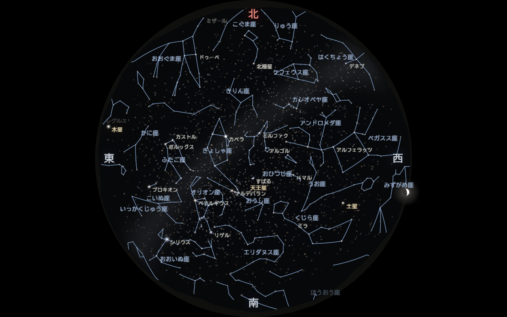
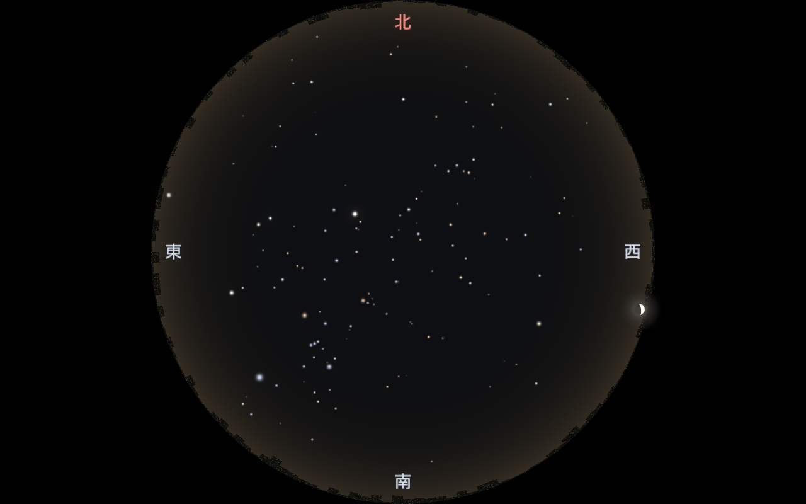
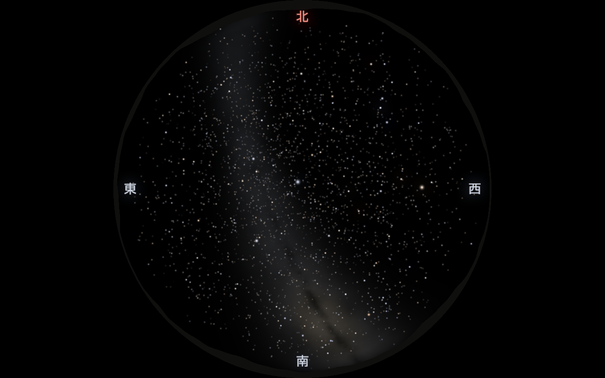

# Projector Planetarium

## すぐ動かす

プロジェクタ（Optoma）がつながっていればプロジェクタに全画面で、無ければ PC の画面にウィンドウで出る。
初回はビルドに数分かかる。止めるのは `Esc`。

| やること | PowerShell | MSYS2 Bash |
|---|---|---|
| 今の星空を出す（リアルモード・現在時刻） | `.\run.ps1` | `./run.sh` |
| 上映（解説つき、約 5 分半） | `.\show.ps1` | `./show.sh` |
| 日時・場所を決めて出す | `.\run.ps1 --time "2026-11-02 22:00" --location achi` | `./run.sh --time "2026-11-02 22:00" --location achi` |
| テストパターン（ピント・明るさ・向きの調整） | `.\run.ps1 --test-pattern` | `./run.sh --test-pattern` |
| PC の画面だけに出す（プロジェクタがあっても） | `.\run.ps1 --output debug` | `./run.sh --output debug` |
| プロジェクタの動作確認 | `python tests/verify/projector.py` | `python tests/verify/projector.py` |
| 全体の検証 | `python tests/verify/verify.py` | `python tests/verify/verify.py` |

実行中に `N` で現在時刻・実時間（×1）に戻る（季節ジャンプや早送りのあとに）。キー操作は `H` で一覧が出る（[§3](#3-キーボード操作)）。プロジェクタは Windows の `Win + P` で「拡張」にしておく。

本番（上映・投影）は Release ビルドが速い：`.\run.ps1 --release`（`show.ps1` は最初から Release）。
Release が Windows のスマート アプリ コントロールに止められたときは、自動で Debug ビルドで起動する。

PowerShell で「このシステムではスクリプトの実行が無効になっているため…読み込むことができません」と出るときは、
PowerShell の実行ポリシーでスクリプトが止められている。次のように起動すれば動く（設定は変わらない）：

```powershell
powershell -ExecutionPolicy Bypass -File .\show.ps1
powershell -ExecutionPolicy Bypass -File .\run.ps1 --release
```

毎回書くのが面倒なら、一度だけ `Set-ExecutionPolicy -Scope CurrentUser RemoteSigned` を実行すると、以後は `.\show.ps1` で動く。

OpenGL で星空を描画し、プロジェクタ（Optoma ML1050ST+）で投影するプログラム。
開発方針は [PLAN.md](PLAN.md)、設計と実装アルゴリズムは [docs/](docs/README.md) を参照。



**できること**

- 恒星 8,920 個（6.5 等まで）、太陽・月（満ち欠け）・惑星を、観測地と日時に合わせた正しい位置に描く
- 観測地の切り替え（大阪大学 ⇔ 長野県阿智村）。街明かり・地平線の景色（街並み／山並み）・見える星の数が変わる
- 天の川、薄明、月明かり、大気差・大気減光、瞬き、光のにじみ
- 星座線・星座名・星や惑星の名前（日本語）、方位、座標グリッド、日時の画面表示
- 季節ジャンプ（巡回・自動巡回）、時間の倍率・逆再生、シナリオの自動再生、場面切り替えのフェード
- リアルモードと 8 種類の幻想モード（オーロラ・星雲・流星群・星座絵・宝石箱・ワープ航行・天の川・水鏡）

まずは PC 画面（デバッグ表示）で確認し、正しく表現できてからプロジェクタ（Optoma ML1050ST+）に出す。

## フォルダ構成

各フォルダの README.md に、中のファイルの役割を書いている。

| フォルダ | 内容 |
|---|---|
| [src/](src/README.md) | C++ のソースコード（天文計算・描画・操作） |
| [shaders/](shaders/README.md) | GLSL シェーダ（星・空・方位の文字・出力） |
| [config/](config/README.md) | 設定ファイル（YAML）：プロジェクタ・投影・観測地・時間・季節・描画 |
| [data/](data/README.md) | 恒星表・星座線・星座名・星の日本語名（CSV） |
| [scripts/](scripts/README.md) | 星表・星座データのダウンロード・変換スクリプト |
| [tests/](tests/README.md) | 自動テスト（天文計算・時刻・季節・シナリオ・キー操作）と、まとめて検証するスクリプト（`tests/verify/`） |
| [third_party/](third_party/README.md) | 同梱の外部ライブラリ（Astronomy Engine、stb） |
| [docs/](docs/README.md) | 設計ドキュメント（工夫点・アルゴリズム）と画像 |
| [.vscode/](.vscode/README.md) | VS Code の設定（ビルド・デバッグ） |
| `build/` | ビルド結果（git 管理外。消しても `run.sh` / `run.ps1` で作り直せる） |
| `dist/` | 配布用フォルダ（git 管理外。`cmake --install` で作る。[§9](#9-配布用フォルダを作るpath-なしで動く)） |

| ファイル | 内容 |
|---|---|
| `run.sh` / `run.ps1` | ビルドして起動するスクリプト（MSYS2 Bash 用 / PowerShell 用） |
| `show.sh` / `show.ps1` | 解説つき上映「大阪から阿智村へ ― 11 月の星空」（約 5 分）を流すスクリプト |
| [shows/](shows/autumn_2026.md) | 上映の台本（YAML）とストーリー構成（.md） |
| `CMakeLists.txt` / `CMakePresets.json` | ビルド設定 |
| [PLAN.md](PLAN.md) | 開発方針・マイルストーン・TODO |
| [LICENSE](LICENSE) | MIT License（データの出典とライセンスは下の「ライセンスとクレジット」） |
| [NEXT_PLAN.md](NEXT_PLAN.md) | 次の計画（抜けていること、コンテンツを良くする案、進める順番、決めてほしいこと） |
| [CLAUDE.md](CLAUDE.md) | AI（Claude Code）向けの作業手順（変更したら `tests/verify/verify.py` を実行する、など） |

---

## 1. 必要なもの（このPCでは導入済み）

| もの | 場所 / 入手 |
|---|---|
| MSYS2（GCC, CMake, Ninja, GLFW, GLEW, GLM, yaml-cpp） | `C:\msys64\mingw64\bin` |
| VS Code ＋ 拡張「C/C++」「CMake Tools」 | 導入済み |

`C:\msys64\mingw64\bin` が **PATH に入っていること**（実行時に `glfw3.dll` などをここから読むため）。確認方法：

```powershell
g++ --version     # 「Built by MSYS2 project」と出ればOK
cmake --version
```

別のPCで一から揃える場合は、MSYS2 を入れて「MSYS2 MINGW64」ターミナルで次を実行し、`C:\msys64\mingw64\bin` を PATH に追加する。

```sh
pacman -S --needed mingw-w64-x86_64-{gcc,gdb,cmake,ninja,glfw,glew,glm,yaml-cpp,clang-tools-extra,python}
```

星のデータ [data/stars.csv](data/stars.csv) はリポジトリに含まれているので、そのまま動く。
作り直す場合（限界等級を変えるなど）は `python scripts/fetch_hyg.py`（[docs/data.md](docs/data.md)）。

---

## 2. 実行方法

### 方法 A：VS Code から（おすすめ）

1. VS Code で `projector_planetarium` フォルダを開く。
2. 初回のみ：下のステータスバー（または `Ctrl+Shift+P` →「CMake: Select Configure Preset」）で
   **「MSYS2 MinGW64 Debug」** を選ぶ。
3. ビルド：**`F7`**（または `Ctrl+Shift+P` →「CMake: Build」）
4. 実行：
   - **`Shift+F5`** … デバッガなしで実行（「CMake: Run Without Debugging」）
   - **`Ctrl+F5`** … gdb でデバッグ実行（「CMake: Debug」）
5. ウィンドウが開いたら、そのウィンドウをクリックしてからキー操作する（ログは VS Code のターミナルに出る）。

### ターミナルから：MSYS2 Bash と PowerShell

ターミナルの種類によってコマンドが違う。VS Code のターミナルの種類は、プロンプトの形で見分けられる。

| ターミナル | プロンプトの例 | 起動スクリプト |
|---|---|---|
| **MSYS2 Bash**（この PC の VS Code の既定） | `banban_iwai@PC MSYS ~/projector_planetarium` `$` | `./run.sh` |
| Git Bash | `banban_iwai@PC MINGW64 ~/projector_planetarium` `$` | `./run.sh` |
| **PowerShell** | `PS C:\Users\banban_iwai\projector_planetarium>` | `.\run.ps1` |

VS Code でターミナルを切り替えるには、ターミナル右上の「＋」の横の「∨」から種類を選ぶ。
どちらのスクリプトも、初回は CMake の設定を自動で行い、変更があったファイルだけ再ビルドしてから起動する。

#### 方法 B：MSYS2 Bash / Git Bash

プロジェクトフォルダで：

```sh
cd /c/Users/banban_iwai/projector_planetarium    # フォルダの移動（パスは / 区切り、C: は /c）

./run.sh                                         # ビルドして起動（Debug, config/projector.yaml）
./run.sh --release                               # Release（最適化）ビルドで起動
./run.sh config/other.yaml                       # 別の設定ファイルで起動
./run.sh --time "2026-12-15 22:00" --grid --compass   # オプション付き（下の表）
```

#### 方法 C：PowerShell

プロジェクトフォルダで：

```powershell
cd C:\Users\banban_iwai\projector_planetarium    # フォルダの移動（パスは \ 区切り）

.\run.ps1                                        # ビルドして起動（Debug, config/projector.yaml）
.\run.ps1 --release                              # Release（最適化）ビルドで起動
.\run.ps1 config\other.yaml                      # 別の設定ファイルで起動
.\run.ps1 --time "2026-12-15 22:00" --grid --compass  # オプション付き（下の表）
```

初めて `.\run.ps1` を実行したとき「このシステムではスクリプトの実行が無効になっている」と出たら、
Windows の既定でスクリプトの実行が禁止されている。次のどちらかで解決する：

```powershell
# (1) 自分のユーザーだけ、ローカルのスクリプトの実行を許可する（1 回だけ。おすすめ）
Set-ExecutionPolicy -Scope CurrentUser RemoteSigned

# (2) 設定を変えずに、その都度許可して実行する
powershell -ExecutionPolicy Bypass -File .\run.ps1 --time "2026-12-15 22:00"
```

#### 注意：取り違えやすい点

| やってしまうこと | 何が起きるか | 正しくは |
|---|---|---|
| PowerShell で `./run.sh` | 関連付けられたアプリでファイルが開かれるだけで、ビルドも起動もされない | PowerShell では `.\run.ps1` |
| PowerShell で `bash run.sh` | `bash` が WSL（Linux）の bash を呼んで失敗する | 同上 |
| MSYS2 Bash で `.\run.ps1` | `\` がエスケープ文字として扱われ、コマンドが見つからない | MSYS2 では `./run.sh` |
| MSYS2 Bash で `cd C:\Users\...` | `\` が消えて別のパスになる | `cd /c/Users/...` |

#### スクリプトを使わない場合（どちらのターミナルでも同じ）

```sh
cmake --preset mingw-debug           # 初回のみ（CMakeLists.txt を変えたときも）
cmake --build --preset mingw-debug   # ビルド
```

実行ファイルの起動だけ書き方が違う：

| | MSYS2 Bash | PowerShell |
|---|---|---|
| Debug | `./build/debug/planetarium.exe` | `.\build\debug\planetarium.exe` |
| Release | `./build/release/planetarium.exe`（`--preset mingw-release` でビルド） | `.\build\release\planetarium.exe` |

### コマンドラインオプション

`run.sh`・`run.ps1`・exe の直接実行のどれでも同じオプションが使える（`--release` だけはスクリプト専用）。

| オプション | 意味 |
|---|---|
| `config.yaml` | 設定ファイル（省略時 `config/projector.yaml`） |
| `--time "2026-12-15 22:00"` | 起動時の日時（地方時）。YAML の `time.start` より優先 |
| `--mode jewel` | 起動時のモード |
| `--location achi` | 起動時の観測地（YAML の `locations` の `id`） |
| `--grid` / `--compass` | 高度・方位グリッド / 方位（北東南西）を表示して起動 |
| `--constellations` / `--constellation-names` / `--labels` / `--info` | 星座線 / 星座名 / 星・惑星の名前 / 画面左下の日時などを表示して起動 |
| `--play` | 起動してすぐシナリオを再生する（上映用） |
| `--operator` | 操作パネル（2 つ目のウィンドウ）を出す。`output: projector` のときは自動で出る |
| `--test-pattern` / `--credits` | テストパターン / クレジットを表示して起動 |
| `--scenario shows/xxx.yaml` | 上映の台本を読む（`--play` と一緒に使う。`show.sh` / `show.ps1` が指定している） |
| `--seek 120` | 台本をその秒数まで進めてから始める（上映の途中の場面を確かめる） |
| `--dump-names "Vega,Saturn"` | `--dump-positions` と一緒に使い、名前で指定した星・惑星の高度・方位も表示する（字幕の確認用） |
| `--dump-narration` | `--scenario` の台本の読み上げ文を表示して終了する（音声を作るスクリプトが使う） |
| `--list-monitors` | つながっているモニタと、どれをプロジェクタとして使うかを表示して終了する |
| `--output projector` / `--monitor 1` | 出力先を設定ファイルより優先して指定する（`--monitor` は番号か名前の一部） |
| `--keep-vsync` | `--benchmark` でも垂直同期を切らない（上映と同じ条件で速さを測る） |
| `--screenshot out.png` | 描いた画面を PNG（`.ppm` なら PPM）で保存してすぐ終了する。検証・資料作り用 |
| `--wait 2` | `--screenshot` の前に待つ秒数（流れ星・ワープなど動く演出を撮るとき） |
| `--record 名前 --count 8 --interval 0.5` | 一定間隔で連続撮影する（`名前_000.png` 〜）。動きの確認用 |
| `--benchmark 5` | 垂直同期を切って 5 秒間描き、平均の fps を表示して終了する |
| `--dump-positions` | 主な天体の高度・方位を表示して終了する（Stellarium などとの比較用） |

例：12/15 22 時の空を、グリッドと方位の文字付きで表示する

```sh
./run.sh --time "2026-12-15 22:00" --grid --compass      # MSYS2 Bash
```

```powershell
.\run.ps1 --time "2026-12-15 22:00" --grid --compass     # PowerShell
```

### テスト

どちらのターミナルでも同じ：

```sh
cmake --build --preset mingw-debug
ctest --preset mingw-debug
```

- `astro`：恒星時・歳差・太陽位置・地平座標変換を、Meeus『Astronomical Algorithms』の例題と、
  独立した天文計算ライブラリ Astronomy Engine の結果に照らして確認する（[docs/astronomy.md §9](docs/astronomy.md#9-検証)）
- `clock`：時間の倍率・逆再生・季節の巡回・シナリオ再生（[tests/README.md](tests/README.md)）
- `controls`：すべてのキー操作（Shift の組み合わせを含む）

### すべての検証をまとめて実行

ビルド・テスト・実際のウィンドウでのキー操作・動き・描画速度・Stellarium との比較・目視用の画像までを 1 つのコマンドで行う（どちらのターミナルでも同じ）：

```sh
python tests/verify/verify.py            # すべて（約 2〜3 分）
python tests/verify/verify.py --quick    # 描画速度と Stellarium を省く
```

結果は `build/verify/report.md` と一覧画像（`sheet_scenes.png` など）にまとまる（[tests/verify/README.md](tests/verify/README.md)）。
これまでの検証の記録は [docs/verification.md](docs/verification.md)。

### 起動したときの表示

ターミナルに次のようなログとキー一覧が出て、1280×800 のウィンドウが開く。

```
monitor[0]: Generic PnP Monitor 2880x1800@60Hz
GL 4.5.0 - Build 32.0.101.8626 / Intel(R) Arc(TM) 130V GPU (8GB)
output: debug 1280x800, location: 大阪大学 吹田キャンパス (34.82, 135.52)
stars: 8920, constellation lines: 743, names: 89 + 35
font: C:/Windows/Fonts/BIZ-UDGothicR.ttc
---- keys ----
  ...
```

画面は天頂を中心にした全天の魚眼で、**北が上・東が左**（寝転んで見上げた空の向き）。円の縁が地平線。
`C` キーで方位（北・東・南・西）、`I` キーで左下に日時・観測地・モードを表示できる。
キーで何かを切り替えると、右下に数秒だけ通知が出る（プロジェクタ出力ではウィンドウタイトルが見えないため）。


ウィンドウタイトルに現在の状態が表示される：

```
[リアル] 2027-01-20 23:41:07 (UTC+9)  >> x3600  季節: 冬  太陽高度 -52°  |  現在 2026-10-31 21:05:12
 ~~~~~~  ~~~~~~~~~~~~~~~~~~~~~~~~~~~  ~~ ~~~~~  ~~~~~~~~  ~~~~~~~~~~~~~       ~~~~~~~~~~~~~~~~~~~~~~~~
 モード   シミュレーション日時（地方時）     │  時間倍率  最後に飛んだ季節  −18°より低いと夜   実際の現在時刻（常に実時間）
                                       └ >> 再生 / << 逆再生 / || 一時停止
```

季節は季節ジャンプ後のみ表示され、自動巡回中は `(巡回中)` が付く。

### 終了

`Esc`、またはウィンドウの × ボタン。

---

## 3. キーボード操作

| キー | 動作 |
|---|---|
| `0` | リアルモード |
| `1`〜`8` | 幻想モード（1 オーロラ / 2 星雲 / 3 流星群 / 4 星座絵 / 5 宝石箱 / 6 ワープ航行 / 7 天の川 / 8 水鏡） |
| `M` / `Shift+M` | 次 / 前のモード（巡回） |
| `S` / `Shift+S` | 次 / 前の季節（巡回、年をまたいで回り続ける） |
| `F1`〜`F5` | 春 / 初夏 / 夏 / 秋 / 冬 へ直接ジャンプ |
| `T` | 季節の自動巡回 ON/OFF |
| `L` / `Shift+L` | 観測地を切り替え（大阪大学 ⇔ 阿智村。YAML の `locations` の順） |
| `↑` / `↓` | 時間倍率を上げる / 下げる |
| `Space` | 一時停止 / 再開 |
| `R` | 逆再生の切り替え |
| `←` / `→` | 1 時間戻す / 進める（`Shift` 付きで 1 日、押しっぱなしで連続） |
| `N` | 現在時刻・×1（実時間）に戻す |
| `K` | 星座の表示を切り替え：線 → 線と名前 → OFF（押すたびに順に） |
| `J` | 星・惑星・月の名前 ON/OFF（星座名とは別） |
| `C` | 方位 北（赤）/ 東 / 南 / 西 を地平線の内側に表示 ON/OFF |
| `I` | 画面左下に日時・倍率・観測地・モード・季節を表示 ON/OFF |
| `P` | シナリオ（YAML の `scenario`）の再生 / 停止 |
| `G` | 高度・方位グリッド ON/OFF（同心円 = 高度 15° ごと、放射線 = 方位 30° ごと、赤線 = 北） |
| `V` | 魚眼（天頂・全天）⇔ 透視（南向き・画角 90°）の切り替え |
| `F11` | 全画面切り替え（ウィンドウが載っているモニタで全画面になる） |
| `X` | テストパターン（プロジェクタの調整用。灰色の段階・暗部の段階・ピント・格子・方位） |
| `[` / `]` | 白の最大値（`render.white_level`）を 0.02 ずつ下げる / 上げる。テストパターンの下端の右端の段が見分けられる値にし、決まったら config に書く |
| `F12` | クレジット（データとライブラリの出典） |
| `B` | 上映の音（ナレーション・BGM）ON/OFF |
| `H` | キー一覧をターミナルに表示 |
| `Esc` | 終了 |

時間倍率の段階（`↑` を押すごと）：

```
×1 → ×10 → ×60 → ×300 → ×600 → ×1800 → ×3600 → ×21600 → ×86400
実時間  10倍  1秒で1分  5分  10分   30分    1時間    6時間     1日
```

---

## 4. 操作例

### 例1：今夜の星空を実時間で見る
1. `0`（リアル）
2. `N`（現在時刻・×1）

→ タイトルが `[リアル] 2026-10-31 21:05:12 (UTC+9)  >> x1  |  現在 2026-10-31 21:05:12` のように、
シミュレーション日時と現在時刻が一致して進む。

### 例2：冬の星空に飛ぶ
1. `F5`

→ `季節: 冬`、日時が 1 月 20 日 21:00 になる。ターミナルに `[season] 冬 -> 2027-01-20 21:00:00 (UTC+9)`。

### 例3：四季を順番に巡る
1. `S` → 冬（次に来る季節）
2. `S` → 春
3. `S` → 初夏
4. `S` → 夏
5. `S` → 秋
6. `S` → 冬（翌年）… と回り続ける。`Shift+S` で逆回り。

### 例4：一晩の星の動きを早送りで見る
1. `F1`（春 21:00）
2. `↑` を 6 回 → `x3600`（1 秒で 1 時間）
3. 星が東から昇り西へ沈む（日周運動）のを見る
4. `Space` で一時停止、`←` / `→` で 1 時間ずつ戻す・進める
5. `N` で現在時刻・実時間に戻る

### 例5：時間を巻き戻す
1. `↑` を 5 回 → `x1800`
2. `R` → タイトルが `<<` になり、時間が逆に進む
3. もう一度 `R` で順方向に戻る

### 例6：夕方から夜になる様子を見る
1. `F5`（冬 21:00）→ `←` を 5 回で 16:00 にする
2. `↑` を 4 回 → `x600`（1 秒で 10 分）
3. 西（右）の空が橙色に染まり、空が暗くなるにつれて明るい星から順に見えてくる
4. タイトルの太陽高度が −18° を下回ると完全な夜空になる

### 例7：方角と星の位置を確かめる
1. `C` で方位の文字を表示 → 上が N（北・赤）、左が E（東）、下が S（南）、右が W（西）。
   見上げた空なので、地図と違って東が左になる
2. `G` でグリッドも表示
3. 北（赤線）の上、高度 30° と 45° の円の間（30° 寄り）に北極星がある（高度 ≒ 大阪の緯度 34.8°）
4. `V` で南向きの透視投影にすると、地平線の上に S が出て、壁に映したときの見え方を確認できる
5. もう一度 `C` / `G` で消える

### 例8：星座を覚える
1. `F5`（冬）
2. `K` を 2 回押して星座の線と名前、`J` で星の名前を表示 → オリオン座・おおいぬ座・ふたご座などと、シリウス・ベテルギウスなどの名前が出る
3. `L` で阿智村に切り替えると、暗い星まで見えて星座の形が分かりやすくなる

### 例9：大阪と阿智村を比べる
1. `L` で観測地を切り替える
2. 大阪：空がオレンジ色に明るく、地平線に街並み、見える星は 4 等級まで。天の川は見えない
3. 阿智村：空が暗く、地平線に山並み、6.5 等級まで見え、天の川が流れる（`F3` の夏がわかりやすい）

| 大阪（冬 22 時） | 阿智村（夏 21 時） |
|---|---|
|  |  |

### 例10：上映用（シナリオを再生）
1. `P` でシナリオ再生。阿智村の夕暮れ → 冬の星座 → 宝石箱 → 大阪の夏 → 天の川 → 流星群 → オーロラ … と自動で進む
2. 場面が変わるたびに 1 秒かけてフェードし、右下に場面の説明が出る
3. もう一度 `P` で停止。内容は YAML の `scenario` で自由に書き換えられる

### 例11：上映用（幻想モードで季節を自動巡回）
1. `1`（オーロラ）など好きな幻想モードを選ぶ
2. `T` → `(巡回中)` になり、30 秒ごとに次の季節へ進む
3. 途中で `M` を押すとモードだけ切り替わり、巡回は続く
4. もう一度 `T` で巡回停止

巡回間隔や季節の日付は [config/projector.yaml](config/projector.yaml) の `season_tour` / `seasons` で変更できる。

---

## 5. 設定（config/projector.yaml）

よく変える項目：

| 項目 | 意味 |
|---|---|
| `output` | `debug`（PC画面にウィンドウ）/ `projector`（プロジェクタにフルスクリーン） |
| `projector.width` / `height` | 出力解像度（ML1050ST+ は 1280×800） |
| `projector.monitor_index` | `output: projector` のときの出力先モニタ番号（起動ログの `monitor[n]`） |
| `location` / `locations` | 起動時の観測地 / 観測地の一覧（緯度・経度・標高・タイムゾーン・夜空の最暗等級）。既定は大阪大学と阿智村 |
| `time.start` | 起動時の日時。`"now"` または `"2026-12-14 22:00"` |
| `time.speed` / `speed_steps` | 起動時の倍率 / `↑↓` で切り替える倍率の段階 |
| `seasons` | 季節プリセット（並び順 = 巡回順） |
| `season_tour` | 自動巡回の ON/OFF と間隔（秒） |
| `mode` | 起動時のモード（`real`, `aurora`, `nebula`, …） |
| `locations[].landscape` | 地平線の景色（`city` 街並み / `mountains` 山並み / `none`） |
| `projection` | 投影方式（`fisheye` / `perspective`）、画角、視線の向き、回転 |
| `render` | 星の明るさ・大きさ、限界等級、大気減光、月の大きさ、光のにじみ、露出・ガンマ、フォント、起動時の補助表示（[docs/rendering.md](docs/rendering.md)） |
| `scenario` | 自動再生する場面の並び（観測地・日時・倍率・モード・表示・メッセージ・長さ） |

YAML を変えたら **再起動するだけ**でよい（再ビルド不要）。

---

## 6. 困ったとき

| 症状 | 対処 |
|---|---|
| `glfw3.dll が見つかりません` などのエラー | `C:\msys64\mingw64\bin` が PATH に入っていない。PATH を追加して VS Code / ターミナルを開き直す |
| exe をダブルクリックするとすぐ閉じる | 設定ファイルのエラーの可能性。ターミナルから実行してメッセージを見る |
| キーが効かない | 星空のウィンドウをクリックしてフォーカスを当てる |
| `cannot open .../data/stars.csv` | `python scripts/fetch_hyg.py` で星のデータを作る |
| 星が出ない・真っ暗／空が明るい | 昼間の時刻になっている。タイトルの太陽高度を見て `F1`〜`F5` で夜に飛ぶ |
| 文字が出ない（ログに `no Japanese font found`） | `render.font` に日本語フォントのファイル（.ttf / .ttc）を指定する |
| `cmake --preset` で失敗する | `build` フォルダを削除してからやり直す |
| VS Code でプリセットが出ない | `Ctrl+Shift+P` →「Developer: Reload Window」 |

---

## 7. 解説つき上映

字幕・ナレーション・BGM・季節の目印（夏の大三角など）・星を指す円を使った 5 分の上映を、1 つのコマンドで流せる。
初回は Windows の日本語音声でナレーションを作り、BGM を作曲する（1 分ほど。2 回目からは台本が変わった場面だけ作り直す）。

```sh
./show.sh                    # MSYS2 Bash
./show.sh --seek 120         # 2 分の場面から（確認用）
```

```powershell
.\show.ps1                   # PowerShell
```

| 上映 | 内容 |
|---|---|
| [大阪から阿智村へ ― 11 月の星空](shows/autumn_2026.md) | 2026 年 11 月 2 日 22:00。街明かりの大阪から、日本一の星空の阿智村へ。天の川、夏の大三角、秋の四辺形、北極星の見つけ方、土星、夜明け前の月・火星・木星、冬の大三角・冬のダイヤモンド、おうし座流星群（5 分） |

上映の日時と場所は台本の先頭（`date`・`location`）で決める。天気は再現しない（いつも晴天）。
上映中も、ふつうのキー操作（`P` で停止、`B` で音 ON/OFF、`F11` で全画面など）が使える。
台本の書き方（字幕・目印・指す円・目が暗さに慣れる演出・流れ星）は [shows/autumn_2026.md](shows/autumn_2026.md) の「使う機能」。
季節の目印は [data/asterisms.csv](data/asterisms.csv) に足せる。

---

## 8. 上映の前に（プロジェクタにつなぐとき）

### プロジェクタの動作確認（スクリプト）

プロジェクタをつないで「拡張」表示にしたら、次を実行する（どちらのターミナルでも同じ）：

```sh
python tests/verify/projector.py            # 自動の確認（約 2 分。プロジェクタに何度か映像が出る）
python tests/verify/projector.py --manual   # 続けて、人が投影を見て確かめる（テストパターン・星空・上映）
```

結果は `build/verify/projector_report.md`。確かめること：

| 確認 | 内容 |
|---|---|
| Windows・アプリから見えるか | Optoma が認識され、「拡張」表示で、解像度がネイティブの 1280×800 |
| 全画面で出るか | 星空がプロジェクタに 1280×800 の全画面で出て、操作パネルは PC の画面に出る |
| 電源 | 充電器につながっているか（バッテリーだと映像がカクつくことがある） |
| 描画速度 | プロジェクタの 60 Hz に間に合う（垂直同期ありで 3 回測った中央値が 55 fps 以上） |
| キー操作 | 全画面のプロジェクタ出力でキーが効く |
| 画像 | テストパターン・上映の場面を撮って一覧にする |

`--manual` では、テストパターン（ピント・台形・明るさ・北の向き）、星空（星の見え方・天の川・黒浮き）、
上映（ナレーション・BGM・字幕）を順にプロジェクタへ映し、見た結果を y/n で答えてレポートに残す。

### 準備

1. **充電器につなぐ**：ノート PC がバッテリーで動いていると、内蔵 GPU が性能を落として映像がカクつく
   （確認スクリプトがバッテリー駆動を警告する）。
2. **Windows の通知を止める**：上映中に通知が出ると、星空の上に投影されてしまう。
   設定 → システム → 通知 →「応答不可」をオンにする。
   または同じ画面の「応答不可を自動的にオンにする」で「全画面モードでアプリを使用するとき」をオンにしておく。
3. **画面を「拡張」にする**：`Win + P` →「拡張」。PC の画面とプロジェクタに別々の画面を出すため。
4. **`run.ps1` / `run.sh` / `show.ps1` / `show.sh` で起動する**（自動で `--output projector` になる。exe を直接起動するときは YAML の `output: projector` か `--output projector`）：プロジェクタに全画面で星空、PC の画面に **操作パネル** が出る。
   操作パネルには出力のプレビュー・日時・モード・表示の状態・キー一覧が出て、操作パネルでもキー操作ができる。
5. **`X` でテストパターン**を出して、ピント・台形・明るさ・北の向きを合わせる（下の表）。もう一度 `X` で星空に戻る。
6. 上映が終わったら `F12` でクレジットを出す（データの出典の表示）。

プロジェクタのモニタは、名前に `projector.monitor_name`（既定 "Optoma"）を含むもの → 主モニタ以外で 1280×800 のもの
→ `monitor_index` の順に探す（Windows のドライバによってはモニタ名が "Generic PnP Monitor" になるため）。
`--list-monitors` で、アプリから見えるモニタと、どれをプロジェクタとして使うかを確かめられる。

> **Windows のスマート アプリ コントロール**が有効な PC では、ビルドし直した exe の実行を Windows が止めることがある
> （「アプリケーション制御ポリシーによってこのファイルがブロックされました」）。コードの問題ではない。
> 上映（`show.sh` / `show.ps1`）とプロジェクタの確認は Release ビルドを使う。止められたら、もう一度ビルドするか、
> Windows セキュリティ → アプリとブラウザーのコントロール → スマート アプリ コントロール の設定を確かめる。

アプリの実行中は、画面が消えたりスリープしたりしないようにしている（終了すると元に戻る）。
マウスカーソルは隠さない（星空の上に出ないよう、上映中は PC の画面側に寄せておく）。

| テストパターンの部分 | 確かめること |
|---|---|
| 下端の 17 段の灰色 | 全部の段が見分けられるか。明るい側（右端）が同じ白に見えたら `render.white_level` を下げる（Optoma では 0.82）。中間の段が詰まって見えたら `render.gamma` |
| 上端の暗い 9 段（0〜32） | 何段目から見えるか（黒つぶれ・黒浮き。暗い星がどこまで見えるかの目安） |
| 中央と四隅の市松模様 | 細かい白黒が見えるか（灰色に溶けていればピントがずれている） |
| 格子 | まっすぐ・等間隔か（台形のゆがみ） |
| 円と方位線（北は赤） | 赤い線が部屋の北を向くか（`projection.rotation_deg` で回す） |

---

## 9. 配布用フォルダを作る（PATH なしで動く）

ビルドしたフォルダの外や、MSYS2 が入っていない PC で動かすときは、必要な DLL・シェーダ・データ・設定を
1 つのフォルダにまとめる。

```sh
cmake --preset mingw-release
cmake --build --preset mingw-release
cmake --install build/release --prefix dist
```

`dist/` に `planetarium.exe`・DLL 6 個・`shaders/`・`data/`・`config/` ができる（約 5 MB）。
フォルダごとコピーして `planetarium.exe` をダブルクリックすれば動く。
実行ファイルは、まず自分と同じフォルダの `shaders/`・`data/` を探し、無ければソースフォルダを使う
（環境変数 `PLANETARIUM_ROOT` で場所を指定することもできる）。

---

## ライセンスとクレジット

プログラム（このリポジトリのコード・シェーダ・スクリプト・ドキュメント）は [MIT License](LICENSE)。
ただし、同梱しているデータとライブラリはそれぞれの条件に従う。

| もの | 出典 | ライセンス |
|---|---|---|
| 恒星データ `data/stars.csv` | [HYG Database v4.1](https://github.com/astronexus/HYG-Database)（astronexus） | **CC BY-SA 4.0**（改変して配布するときも同じライセンスで、出典を表示する） |
| 星座線・星座名 `data/constellation_*.csv` | [d3-celestial](https://github.com/ofrohn/d3-celestial)（Olaf Frohn） | BSD-3-Clause |
| `third_party/astronomy/` | [Astronomy Engine](https://github.com/cosinekitty/astronomy)（Don Cross） | MIT |
| `third_party/stb/` | [stb](https://github.com/nothings/stb)（Sean Barrett） | MIT / Public Domain |
| `third_party/miniaudio/` | [miniaudio](https://github.com/mackron/miniaudio)（David Reid） | Public Domain / MIT-0 |
| 上映のナレーション | Windows の音声合成（Microsoft Haruka）で各自の PC で作る。リポジトリには含めない | — |
| 上映の BGM | `scripts/make_bgm.py` がその場で作曲する（このリポジトリの一部として MIT） | MIT |
| 日本語フォント | Windows に入っているもの（BIZ UDゴシックなど）を実行時に読む。同梱しない | — |

上映では `F12` で同じ内容を画面に出せる。
