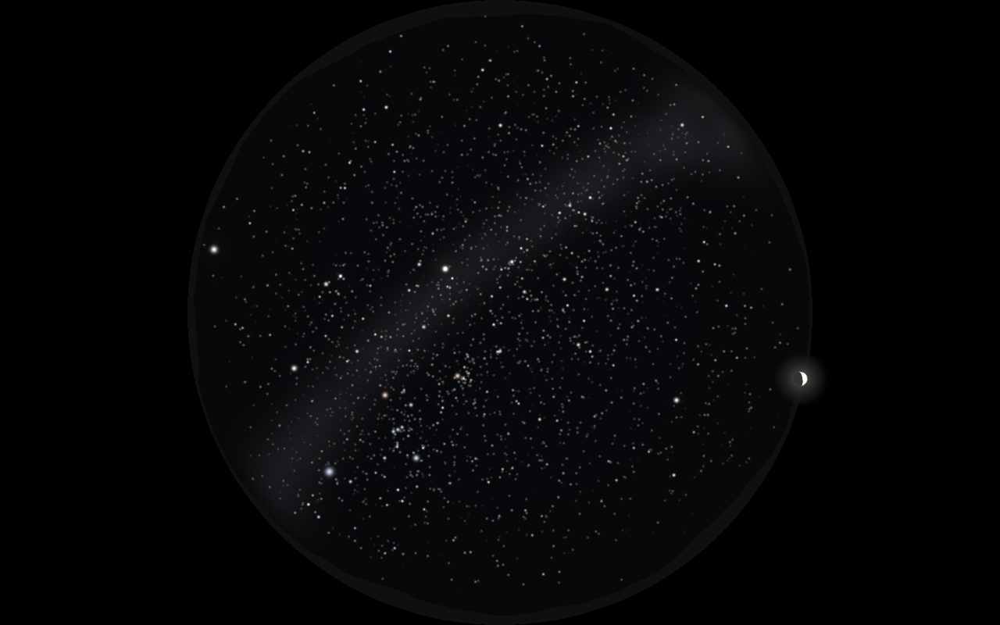
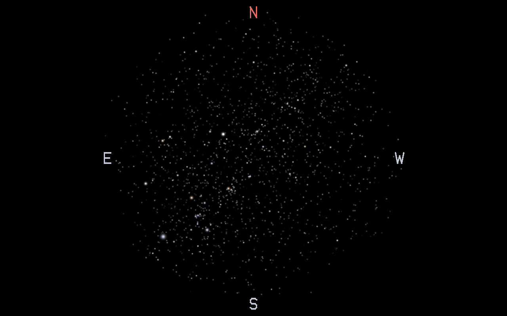

# Projector Planetarium

OpenGL で星空を描画し、プロジェクタ（Optoma ML1050ST+）で投影するプログラム。
開発方針は [PLAN.md](PLAN.md)、設計と実装アルゴリズムは [docs/](docs/README.md) を参照。



> 現段階：恒星（6.5 等まで約 9,000 星）を正しい位置・明るさ・色で描画し、薄明の空、大気差・大気減光、
> 魚眼／透視投影、季節・時間の操作ができる。月・惑星・星座線・幻想モードの固有演出はこれから。
> まずは PC 画面（デバッグ表示）で確認し、正しく表現できてからプロジェクタに出す。

## フォルダ構成

各フォルダの README.md に、中のファイルの役割を書いている。

| フォルダ | 内容 |
|---|---|
| [src/](src/README.md) | C++ のソースコード（天文計算・描画・操作） |
| [shaders/](shaders/README.md) | GLSL シェーダ（星・空・方位の文字・出力） |
| [config/](config/README.md) | 設定ファイル（YAML）：プロジェクタ・投影・観測地・時間・季節・描画 |
| [data/](data/README.md) | 恒星表 `stars.csv`（HYG Database 由来） |
| [scripts/](scripts/README.md) | 星表のダウンロード・変換スクリプト |
| [tests/](tests/README.md) | 天文計算のテスト |
| [docs/](docs/README.md) | 設計ドキュメント（工夫点・アルゴリズム）と画像 |
| [.vscode/](.vscode/README.md) | VS Code の設定（ビルド・デバッグ） |
| `build/` | ビルド結果（git 管理外。消しても `run.sh` / `run.ps1` で作り直せる） |

| ファイル | 内容 |
|---|---|
| `run.sh` / `run.ps1` | ビルドして起動するスクリプト（MSYS2 Bash 用 / PowerShell 用） |
| `CMakeLists.txt` / `CMakePresets.json` | ビルド設定 |
| [PLAN.md](PLAN.md) | 開発方針・マイルストーン |

---

## 1. 必要なもの（このPCでは導入済み）

| もの | 場所 / 入手 |
|---|---|
| MSYS2（GCC, CMake, Ninja, GLFW, GLEW, GLM, yaml-cpp） | `C:\msys64\mingw64\bin` |
| VS Code ＋ 拡張「C/C++」「CMake Tools」 | 導入済み |

`C:\msys64\mingw64\bin` が **PATH に入っていること**（実行時に `glfw3.dll` などをここから読むため）。確認方法：

```powershell
g++ --version     # 「Built by MSYS2 project」と出ればOK
cmake --version
```

別のPCで一から揃える場合は、MSYS2 を入れて「MSYS2 MINGW64」ターミナルで次を実行し、`C:\msys64\mingw64\bin` を PATH に追加する。

```sh
pacman -S --needed mingw-w64-x86_64-{gcc,gdb,cmake,ninja,glfw,glew,glm,yaml-cpp,clang-tools-extra,python}
```

星のデータ [data/stars.csv](data/stars.csv) はリポジトリに含まれているので、そのまま動く。
作り直す場合（限界等級を変えるなど）は `python scripts/fetch_hyg.py`（[docs/data.md](docs/data.md)）。

---

## 2. 実行方法

### 方法 A：VS Code から（おすすめ）

1. VS Code で `projector_planetarium` フォルダを開く。
2. 初回のみ：下のステータスバー（または `Ctrl+Shift+P` →「CMake: Select Configure Preset」）で
   **「MSYS2 MinGW64 Debug」** を選ぶ。
3. ビルド：**`F7`**（または `Ctrl+Shift+P` →「CMake: Build」）
4. 実行：
   - **`Shift+F5`** … デバッガなしで実行（「CMake: Run Without Debugging」）
   - **`Ctrl+F5`** … gdb でデバッグ実行（「CMake: Debug」）
5. ウィンドウが開いたら、そのウィンドウをクリックしてからキー操作する（ログは VS Code のターミナルに出る）。

### ターミナルから：MSYS2 Bash と PowerShell

ターミナルの種類によってコマンドが違う。VS Code のターミナルの種類は、プロンプトの形で見分けられる。

| ターミナル | プロンプトの例 | 起動スクリプト |
|---|---|---|
| **MSYS2 Bash**（この PC の VS Code の既定） | `banban_iwai@PC MSYS ~/projector_planetarium` `$` | `./run.sh` |
| Git Bash | `banban_iwai@PC MINGW64 ~/projector_planetarium` `$` | `./run.sh` |
| **PowerShell** | `PS C:\Users\banban_iwai\projector_planetarium>` | `.\run.ps1` |

VS Code でターミナルを切り替えるには、ターミナル右上の「＋」の横の「∨」から種類を選ぶ。
どちらのスクリプトも、初回は CMake の設定を自動で行い、変更があったファイルだけ再ビルドしてから起動する。

#### 方法 B：MSYS2 Bash / Git Bash

プロジェクトフォルダで：

```sh
cd /c/Users/banban_iwai/projector_planetarium    # フォルダの移動（パスは / 区切り、C: は /c）

./run.sh                                         # ビルドして起動（Debug, config/projector.yaml）
./run.sh --release                               # Release（最適化）ビルドで起動
./run.sh config/other.yaml                       # 別の設定ファイルで起動
./run.sh --time "2026-12-15 22:00" --grid --compass   # オプション付き（下の表）
```

#### 方法 C：PowerShell

プロジェクトフォルダで：

```powershell
cd C:\Users\banban_iwai\projector_planetarium    # フォルダの移動（パスは \ 区切り）

.\run.ps1                                        # ビルドして起動（Debug, config/projector.yaml）
.\run.ps1 --release                              # Release（最適化）ビルドで起動
.\run.ps1 config\other.yaml                      # 別の設定ファイルで起動
.\run.ps1 --time "2026-12-15 22:00" --grid --compass  # オプション付き（下の表）
```

初めて `.\run.ps1` を実行したとき「このシステムではスクリプトの実行が無効になっている」と出たら、
Windows の既定でスクリプトの実行が禁止されている。次のどちらかで解決する：

```powershell
# (1) 自分のユーザーだけ、ローカルのスクリプトの実行を許可する（1 回だけ。おすすめ）
Set-ExecutionPolicy -Scope CurrentUser RemoteSigned

# (2) 設定を変えずに、その都度許可して実行する
powershell -ExecutionPolicy Bypass -File .\run.ps1 --time "2026-12-15 22:00"
```

#### 注意：取り違えやすい点

| やってしまうこと | 何が起きるか | 正しくは |
|---|---|---|
| PowerShell で `./run.sh` | 関連付けられたアプリでファイルが開かれるだけで、ビルドも起動もされない | PowerShell では `.\run.ps1` |
| PowerShell で `bash run.sh` | `bash` が WSL（Linux）の bash を呼んで失敗する | 同上 |
| MSYS2 Bash で `.\run.ps1` | `\` がエスケープ文字として扱われ、コマンドが見つからない | MSYS2 では `./run.sh` |
| MSYS2 Bash で `cd C:\Users\...` | `\` が消えて別のパスになる | `cd /c/Users/...` |

#### スクリプトを使わない場合（どちらのターミナルでも同じ）

```sh
cmake --preset mingw-debug           # 初回のみ（CMakeLists.txt を変えたときも）
cmake --build --preset mingw-debug   # ビルド
```

実行ファイルの起動だけ書き方が違う：

| | MSYS2 Bash | PowerShell |
|---|---|---|
| Debug | `./build/debug/planetarium.exe` | `.\build\debug\planetarium.exe` |
| Release | `./build/release/planetarium.exe`（`--preset mingw-release` でビルド） | `.\build\release\planetarium.exe` |

### コマンドラインオプション

`run.sh`・`run.ps1`・exe の直接実行のどれでも同じオプションが使える（`--release` だけはスクリプト専用）。

| オプション | 意味 |
|---|---|
| `config.yaml` | 設定ファイル（省略時 `config/projector.yaml`） |
| `--time "2026-12-15 22:00"` | 起動時の日時（地方時）。YAML の `time.start` より優先 |
| `--mode jewel` | 起動時のモード |
| `--grid` | 高度・方位グリッドを表示して起動 |
| `--compass` | 方位の文字 N/E/S/W を表示して起動 |
| `--screenshot out.ppm` | 3 フレーム描いて画像（PPM）を保存し、すぐ終了する。検証・資料作り用 |

例：12/15 22 時の空を、グリッドと方位の文字付きで表示する

```sh
./run.sh --time "2026-12-15 22:00" --grid --compass      # MSYS2 Bash
```

```powershell
.\run.ps1 --time "2026-12-15 22:00" --grid --compass     # PowerShell
```

### テスト（天文計算）

どちらのターミナルでも同じ：

```sh
cmake --build --preset mingw-debug
ctest --preset mingw-debug
```

Meeus『Astronomical Algorithms』の例題と比べて、恒星時・歳差・太陽位置・地平座標変換を確認する（[docs/astronomy.md §9](docs/astronomy.md#9-検証)）。

### 起動したときの表示

ターミナルに次のようなログとキー一覧が出て、1280×800 のウィンドウが開く。

```
monitor[0]: Generic PnP Monitor 2880x1800@60Hz
GL 4.5.0 - Build 32.0.101.8626 / Intel(R) Arc(TM) 130V GPU (8GB)
output: debug 1280x800, observer: 大阪大学 吹田キャンパス (34.82, 135.52)
stars: 8920
---- keys ----
  ...
```

画面は天頂を中心にした全天の魚眼で、**北が上・東が左**（寝転んで見上げた空の向き）。円の縁が地平線。
`C` キーで方位の文字（N/E/S/W）を表示できる。



ウィンドウタイトルに現在の状態が表示される：

```
[リアル] 2027-01-20 23:41:07 (UTC+9)  >> x3600  季節: 冬  太陽高度 -52°  |  現在 2026-10-31 21:05:12
 ~~~~~~  ~~~~~~~~~~~~~~~~~~~~~~~~~~~  ~~ ~~~~~  ~~~~~~~~  ~~~~~~~~~~~~~       ~~~~~~~~~~~~~~~~~~~~~~~~
 モード   シミュレーション日時（地方時）     │  時間倍率  最後に飛んだ季節  −18°より低いと夜   実際の現在時刻（常に実時間）
                                       └ >> 再生 / << 逆再生 / || 一時停止
```

季節は季節ジャンプ後のみ表示され、自動巡回中は `(巡回中)` が付く。

### 終了

`Esc`、またはウィンドウの × ボタン。

---

## 3. キーボード操作

| キー | 動作 |
|---|---|
| `0` | リアルモード |
| `1`〜`8` | 幻想モード（1 オーロラ / 2 星雲 / 3 流星群 / 4 星座絵 / 5 宝石箱 / 6 ワープ航行 / 7 天の川 / 8 水鏡） |
| `M` / `Shift+M` | 次 / 前のモード（巡回） |
| `S` / `Shift+S` | 次 / 前の季節（巡回、年をまたいで回り続ける） |
| `F1`〜`F5` | 春 / 初夏 / 夏 / 秋 / 冬 へ直接ジャンプ |
| `T` | 季節の自動巡回 ON/OFF |
| `↑` / `↓` | 時間倍率を上げる / 下げる |
| `Space` | 一時停止 / 再開 |
| `R` | 逆再生の切り替え |
| `←` / `→` | 1 時間戻す / 進める（`Shift` 付きで 1 日、押しっぱなしで連続） |
| `N` | 現在時刻・×1（実時間）に戻す |
| `C` | 方位の文字 N（北・赤）/ E / S / W を地平線の内側に表示 ON/OFF |
| `G` | 高度・方位グリッド ON/OFF（同心円 = 高度 15° ごと、放射線 = 方位 30° ごと、赤線 = 北） |
| `V` | 魚眼（天頂・全天）⇔ 透視（南向き・画角 90°）の切り替え |
| `F11` | 全画面切り替え |
| `H` | キー一覧をターミナルに表示 |
| `Esc` | 終了 |

時間倍率の段階（`↑` を押すごと）：

```
×1 → ×10 → ×60 → ×300 → ×600 → ×1800 → ×3600 → ×21600 → ×86400
実時間  10倍  1秒で1分  5分  10分   30分    1時間    6時間     1日
```

---

## 4. 操作例

### 例1：今夜の星空を実時間で見る
1. `0`（リアル）
2. `N`（現在時刻・×1）

→ タイトルが `[リアル] 2026-10-31 21:05:12 (UTC+9)  >> x1  |  現在 2026-10-31 21:05:12` のように、
シミュレーション日時と現在時刻が一致して進む。

### 例2：冬の星空に飛ぶ
1. `F5`

→ `季節: 冬`、日時が 1 月 20 日 21:00 になる。ターミナルに `[season] 冬 -> 2027-01-20 21:00:00 (UTC+9)`。

### 例3：四季を順番に巡る
1. `S` → 冬（次に来る季節）
2. `S` → 春
3. `S` → 初夏
4. `S` → 夏
5. `S` → 秋
6. `S` → 冬（翌年）… と回り続ける。`Shift+S` で逆回り。

### 例4：一晩の星の動きを早送りで見る
1. `F1`（春 21:00）
2. `↑` を 6 回 → `x3600`（1 秒で 1 時間）
3. 星が東から昇り西へ沈む（日周運動）のを見る
4. `Space` で一時停止、`←` / `→` で 1 時間ずつ戻す・進める
5. `N` で現在時刻・実時間に戻る

### 例5：時間を巻き戻す
1. `↑` を 5 回 → `x1800`
2. `R` → タイトルが `<<` になり、時間が逆に進む
3. もう一度 `R` で順方向に戻る

### 例6：夕方から夜になる様子を見る
1. `F5`（冬 21:00）→ `←` を 5 回で 16:00 にする
2. `↑` を 4 回 → `x600`（1 秒で 10 分）
3. 西（右）の空が橙色に染まり、空が暗くなるにつれて明るい星から順に見えてくる
4. タイトルの太陽高度が −18° を下回ると完全な夜空になる

### 例7：方角と星の位置を確かめる
1. `C` で方位の文字を表示 → 上が N（北・赤）、左が E（東）、下が S（南）、右が W（西）。
   見上げた空なので、地図と違って東が左になる
2. `G` でグリッドも表示
3. 北（赤線）の上、高度 30° と 45° の円の間（30° 寄り）に北極星がある（高度 ≒ 大阪の緯度 34.8°）
4. `V` で南向きの透視投影にすると、地平線の上に S が出て、壁に映したときの見え方を確認できる
5. もう一度 `C` / `G` で消える

### 例8：上映用（幻想モードで季節を自動巡回）
1. `1`（オーロラ）など好きな幻想モードを選ぶ
2. `T` → `(巡回中)` になり、30 秒ごとに次の季節へ進む
3. 途中で `M` を押すとモードだけ切り替わり、巡回は続く
4. もう一度 `T` で巡回停止

巡回間隔や季節の日付は [config/projector.yaml](config/projector.yaml) の `season_tour` / `seasons` で変更できる。

---

## 5. 設定（config/projector.yaml）

よく変える項目：

| 項目 | 意味 |
|---|---|
| `output` | `debug`（PC画面にウィンドウ）/ `projector`（プロジェクタにフルスクリーン） |
| `projector.width` / `height` | 出力解像度（ML1050ST+ は 1280×800） |
| `projector.monitor_index` | `output: projector` のときの出力先モニタ番号（起動ログの `monitor[n]`） |
| `observer` | 観測地（緯度・経度・タイムゾーン） |
| `time.start` | 起動時の日時。`"now"` または `"2026-12-14 22:00"` |
| `time.speed` / `speed_steps` | 起動時の倍率 / `↑↓` で切り替える倍率の段階 |
| `seasons` | 季節プリセット（並び順 = 巡回順） |
| `season_tour` | 自動巡回の ON/OFF と間隔（秒） |
| `mode` | 起動時のモード（`real`, `aurora`, `nebula`, …） |
| `projection` | 投影方式（`fisheye` / `perspective`）、画角、視線の向き、回転 |
| `render` | 星の明るさ・大きさ、限界等級、大気減光、露出・ガンマ（[docs/rendering.md](docs/rendering.md)） |

YAML を変えたら **再起動するだけ**でよい（再ビルド不要）。

---

## 6. 困ったとき

| 症状 | 対処 |
|---|---|
| `glfw3.dll が見つかりません` などのエラー | `C:\msys64\mingw64\bin` が PATH に入っていない。PATH を追加して VS Code / ターミナルを開き直す |
| exe をダブルクリックするとすぐ閉じる | 設定ファイルのエラーの可能性。ターミナルから実行してメッセージを見る |
| キーが効かない | 星空のウィンドウをクリックしてフォーカスを当てる |
| `cannot open .../data/stars.csv` | `python scripts/fetch_hyg.py` で星のデータを作る |
| 星が出ない・真っ暗／空が明るい | 昼間の時刻になっている。タイトルの太陽高度を見て `F1`〜`F5` で夜に飛ぶ |
| `cmake --preset` で失敗する | `build` フォルダを削除してからやり直す |
| VS Code でプリセットが出ない | `Ctrl+Shift+P` →「Developer: Reload Window」 |
