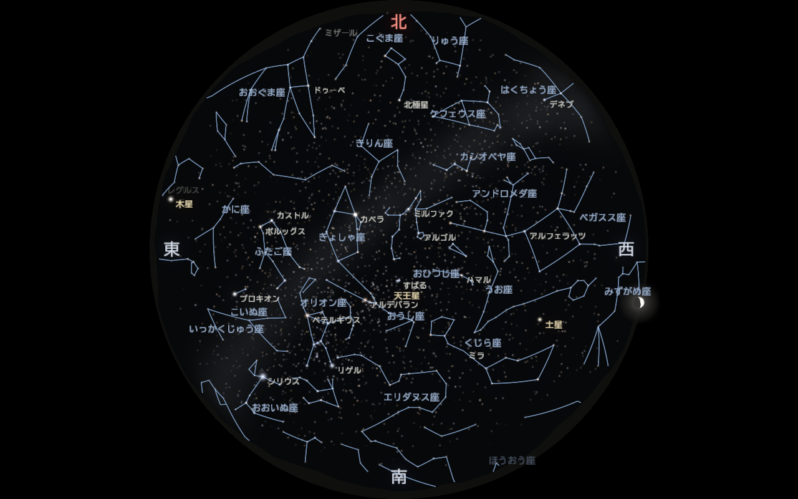
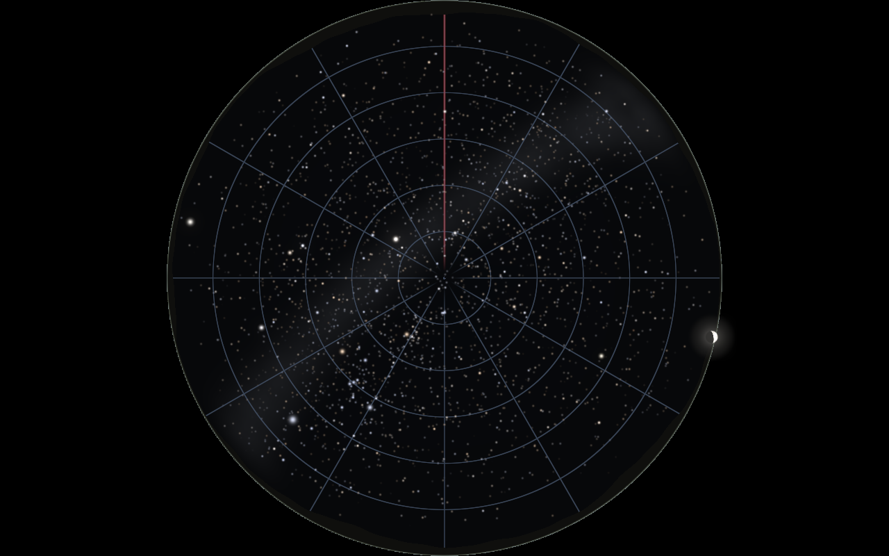

# 設計ドキュメント

どのような星空プログラムを作るか、その工夫点と実装アルゴリズムをまとめる。
実行方法は [../README.md](../README.md)、全体の計画は [../PLAN.md](../PLAN.md) を参照。

| ドキュメント | 内容 |
|---|---|
| [astronomy.md](astronomy.md) | 天文計算：座標系、時刻と恒星時、歳差、地平座標への変換、大気差、太陽・月・惑星の位置、検証方法 |
| [rendering.md](rendering.md) | 描画：パイプライン、魚眼・透視投影、星の明るさ・大きさ・色、瞬き、大気減光、薄明、天の川、光害と景色、月・惑星、線、文字、ブルーム、フェード、モード |
| [verification.md](verification.md) | 検証の記録：テスト、Stellarium との比較、キー操作、動き、描画速度 |
| [data.md](data.md) | データ：HYG 星表、星座線・星座名、星の日本語名、変換スクリプト、ライセンス |

*2026-12-15 22:00 JST、長野県阿智村。天頂を中心に地平線までの全天を描いた魚眼の画像。北が上、東が左（見上げた空の向き）。
星座線・日本語の名前・方位を表示。東に木星、西に土星と沈みかけの三日月、縁には山並みのシルエット。*

---

## 目指すもの

- **正しい空**：日本（既定は大阪大学吹田キャンパスと長野県阿智村）の、指定日時に実際に見える星を正しい位置に出す。
  季節・時刻を動かしたときの星の動き（日周運動・年周の移り変わり）も正しく再現する。
- **プロジェクタで見て美しい**：Optoma ML1050ST+（1280×800、1000 lm、DLP）で天井・壁に投影したとき、
  星が「点」として締まって見え、明るさの差が分かり、空の暗部が浮かないようにする。
- **演出の幅**：同じ星の位置計算の上に、リアルモードと複数の幻想モードを載せる。

## 工夫点のまとめ

### 天文計算
1. **行列 1 つで恒星全体を変換**：J2000 → 当日の分点（歳差）→ 地平座標（恒星時・緯度）を 3×3 行列 1 つにまとめる。
   CPU は毎フレームこの行列を作るだけ。約 9,000 個の星の変換は GPU の頂点シェーダが行う。
   → 時間倍率を ×86400 にしても負荷は変わらない。（[astronomy.md §5](astronomy.md#5-地平座標への変換)）
2. **歳差を入れる**：J2000 から 26 年で約 0.36° ずれる。月の直径（0.5°）に近く、星座の形の比較で分かる差なので省略しない。
3. **大気差・大気減光**：地平線付近で星が約 0.5° 浮き上がり、暗くなる。地平線近くの空の「らしさ」に効く。
4. **教科書の例題でテスト**：Meeus『Astronomical Algorithms』の例題と照合する自動テスト（`ctest`）を用意した。

### 描画
5. **等級 → 光量を物理的に計算し、飽和した分は大きさへ**：芯の明るさは 1 で頭打ちにし、
   それより明るい星は星像を広げて表す。暗い星は小さく暗く、明るい星は大きく光芒付きになる。（[rendering.md §4](rendering.md#4-星の明るさと大きさ)）
6. **色は B−V → 温度 → 黒体放射 → sRGB**：色指数から有効温度を求め、プランクの放射則を CIE 等色関数で積分して色を作る。
   リアルモードでは人の目の夜間視に合わせて彩度を下げる。
7. **線形 HDR で合成してから最後にガンマ**：星の重なりや光芒を物理的に正しく足し、最後に露出・ガンマを 1 回だけかける。
   暗部のグラデーションが縞にならないようディザを入れる（プロジェクタは暗部の階調が粗い）。
8. **投影を 1 か所に集約**：魚眼・透視、回転、反転は共通の GLSL（`projection.glsl`）にまとめた。
   星は「順投影」、背景は画素ごとの「逆投影」で同じ式を使うので、星とグリッドが必ず一致する。
9. **太陽高度で空と見える星が変わる**：薄明の進行に合わせて空の色と限界等級を変える。早送りすると夕方から夜へ自然に移る。
10. **モードは「見せ方のパラメータ」**：彩度・大きさ・明るさ・瞬き・光芒・空の色味をモードごとに持つ。
    星の位置計算は全モード共通なので、季節ジャンプ・時間倍率はどのモードでも同じく効く。

### 観測地・天体・演出
11. **観測地ごとの空を 1 つの値で**：観測地の「夜空の最暗等級」から、見える星の数・光害の明るみ・天の川の濃さをまとめて決める。
    大阪（4.0 等）は街明かりで天の川が見えず、阿智村（6.5 等）では天の川が流れる。地平線には街並み／山並みのシルエット。（[rendering.md §10](rendering.md#10-観測地ごとの空光害と地平線の景色)）
12. **景色の関数を全シェーダで共有**：方位ごとの地面の高さを 1 つの関数にし、空・星・月・線・文字のすべてが同じ山や建物に隠れる。
13. **天の川を式で作る**：画像を使わず、銀河座標の帯 + 雲のむら（fBm ノイズ）+ 暗黒帯で描く。星と同じ行列で動く。
14. **月の満ち欠けを球の陰影で**：円盤の各点を球面とみなし、画面上で太陽の来る向きとの内積で明暗を付ける。投影・反転しても正しい向き。
15. **月・惑星は実績のあるライブラリで**：Astronomy Engine（MIT）で位置・等級・満ち欠けを計算し、自分の座標変換とも突き合わせてテストする。
16. **日本語の文字をフォントから直接**：Windows 標準の日本語フォントから使う文字だけをテクスチャに焼き、基準点は投影・形はピクセルで描く。
17. **プロジェクタ前提の画面表示**：ウィンドウタイトルが見えない投影中のために、切り替え時の通知（右下）と日時表示（左下、I キー）を、魚眼の円の外の黒い部分に出す。
18. **上映のための仕組み**：場面の切り替えを 1 秒でフェード。YAML に書いた場面を順に再生するシナリオ機能（P キー）。

### 検証のしやすさ
19. **方位表示（C キー）とグリッド表示（G キー）**：地平線の内側に 北（赤）/東/南/西 を出して、どちらが北かすぐ分かる。
    グリッドは高度 15° ごと、方位 30° ごとの線と、北（赤）・地平線を表示して、向きと位置を確かめられる。
20. **スクリーンショットオプション**：`--time` `--location` `--mode` `--grid` `--screenshot out.png` で特定の日時の画像を自動で保存できる。
    Stellarium の同日時の画面と並べて比較できる。docs/images の画像もすべてこれで作った。
21. **独立した実装とのテスト**：自作の座標変換を、教科書の例題と Astronomy Engine の両方と比べる（`ctest`）。
    さらに Stellarium と 32 天体の位置を比べ、差は最大 39″（画面の 1 画素の 5%）だった（[verification.md](verification.md)）。
22. **名前が重ならない配置**：シェーダと同じ投影を CPU でも計算し、優先度の高い名前から空いている位置に置く。
23. **検証を 1 コマンドで**：`python tests/verify/verify.py` が、ビルド・テスト・実際のウィンドウへのキー入力・連続撮影による動きの確認・
    描画速度・Stellarium との比較・目視用の一覧画像までを行い、`build/verify/report.md` にまとめる（[tests/verify/](../tests/verify/README.md)）。

*G キーのグリッド表示。同心円は高度 15° ごと（外周が地平線）、放射線は方位 30° ごと、赤線が北。*
