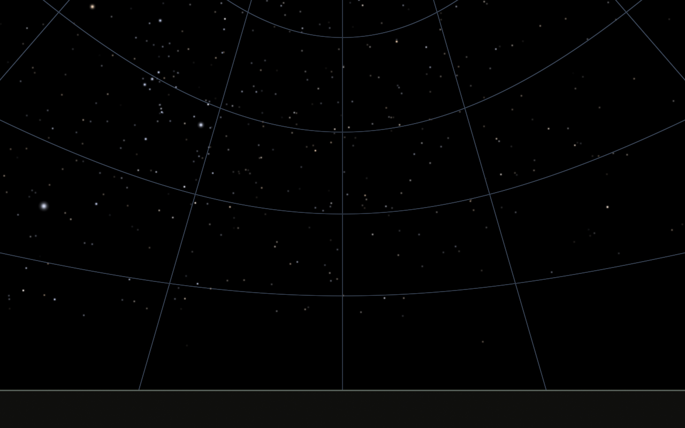
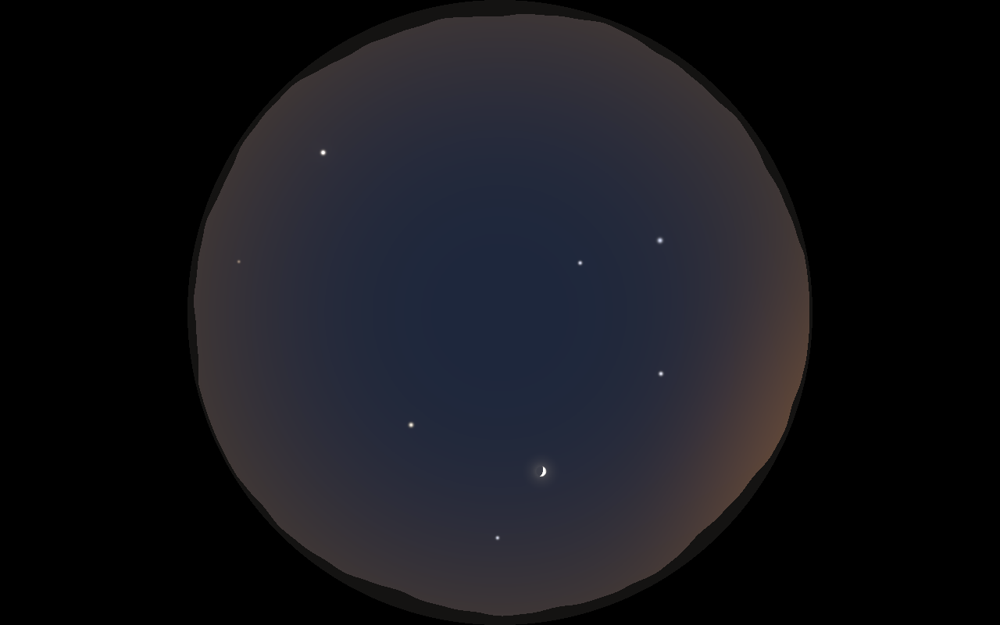
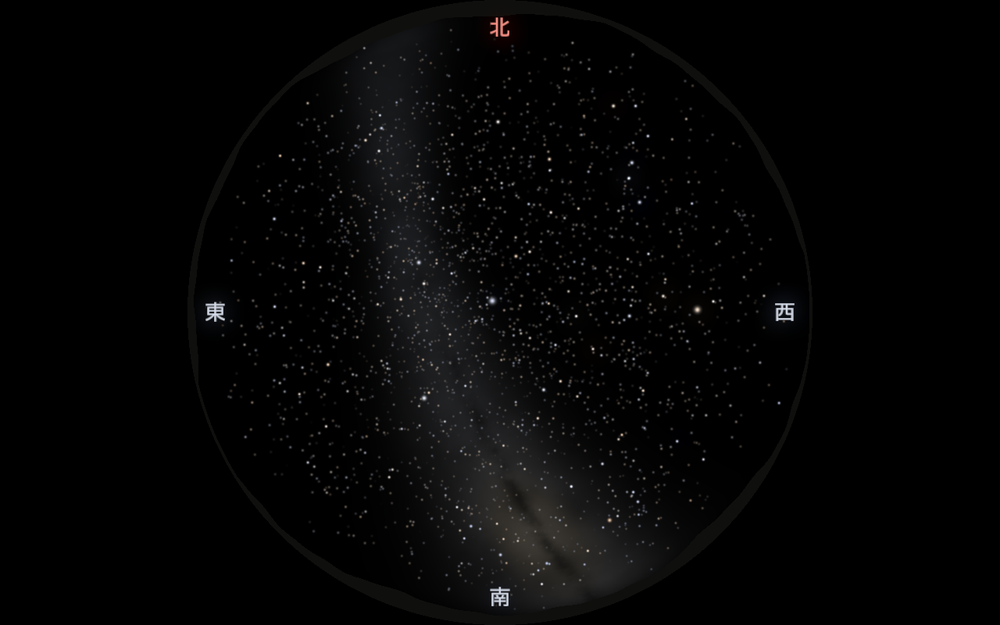
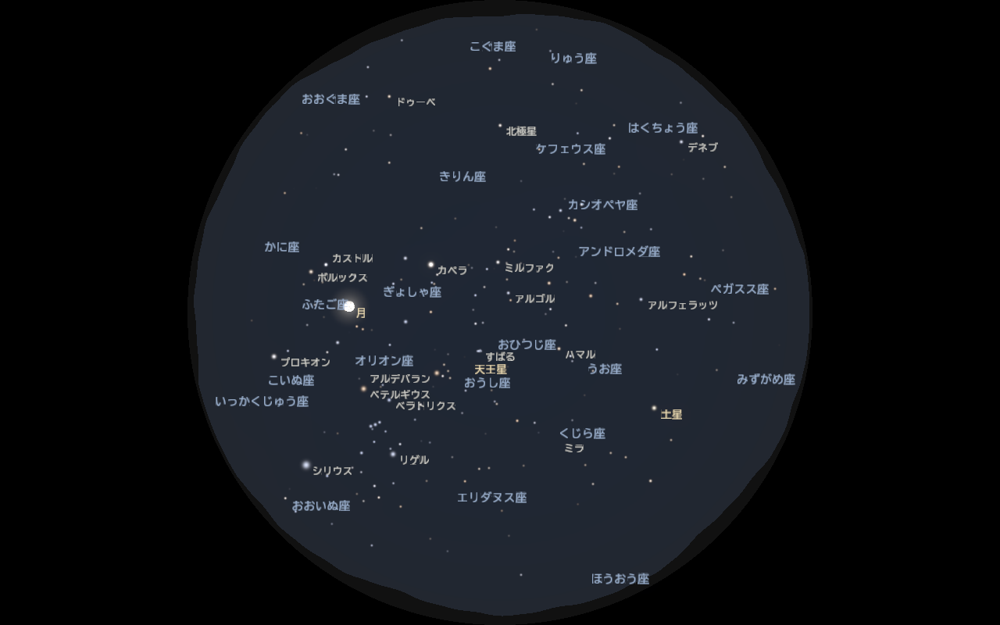
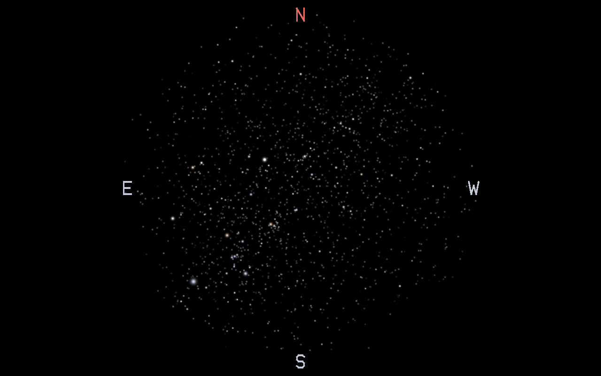
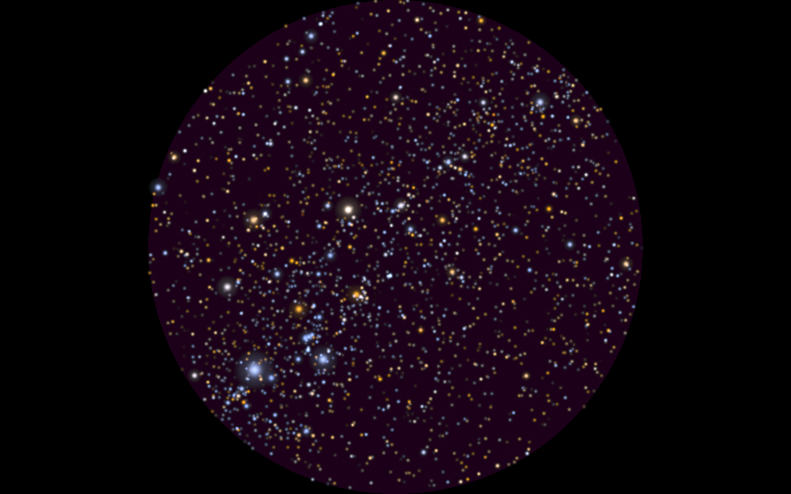
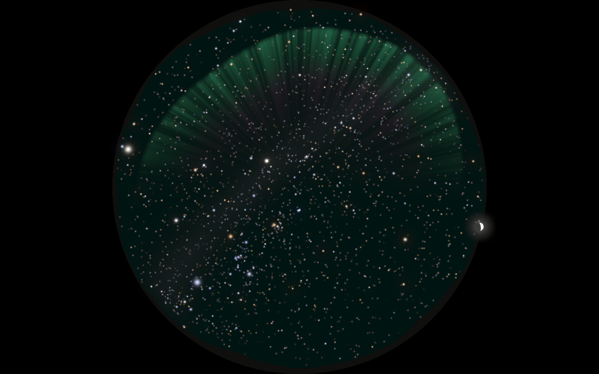
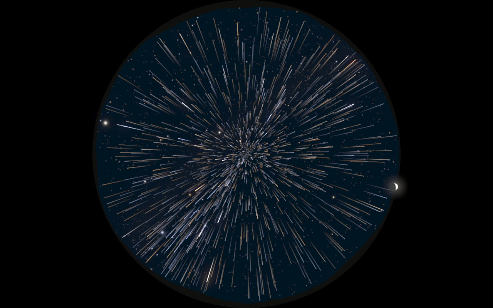
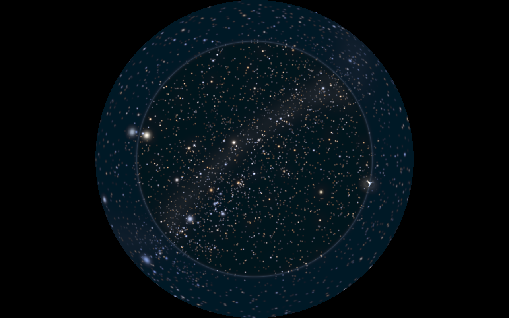
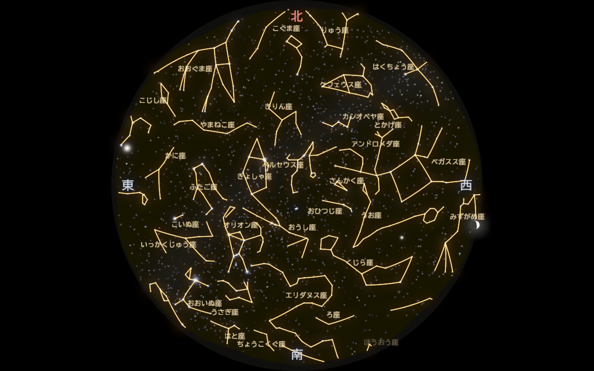

# 描画

実装は [src/sky_renderer.cpp](../src/sky_renderer.cpp) と [shaders/](../shaders/)。
数値の既定値は [config/projector.yaml](../config/projector.yaml) の `render:` で変えられる。

## 1. パイプライン

```
毎フレーム
 ├─ CPU: 時刻を進める → J2000→地平の行列 M、太陽・月・惑星の位置（Astronomy Engine）、
 │       流れ星・ワープの線、文字（名前・方位・画面表示）を用意
 │
 │   ここから HDR バッファ (RGBA16F, 線形) に描く
 ├─ ① 背景      fullscreen.vert + sky.frag        画素ごとに逆投影し、空の色・天の川・オーロラ/星雲・光害・景色・グリッド
 ├─ ② 星座線    lines.vert/geom/frag              大円に沿って分割した線分を、太さのある四角形に広げて加算
 ├─ ③ 恒星・惑星 stars.vert + stars.frag           1 星 = 1 点スプライト。大気差・減光・瞬き・明るさ・大きさ
 ├─ ④ 月・太陽  body.vert + body.frag             円盤（満ち欠け・海の模様）と周りのにじみ
 ├─ ⑤ 演出の線  lines.*                           流れ星・ワープの光跡（尾から頭へのグラデーション）
 ├─ ⑥ 文字      text.vert + text.frag             名前・方位・画面表示（日本語フォントのアトラス）
 │
 ├─ ⑦ ブルーム  fullscreen.vert + bloom.frag      明るい部分を半分の解像度に取り出し、ガウスぼかし ×2
 └─ ⑧ 出力      fullscreen.vert + post.frag       水鏡の映り込み → にじみを足す → フェード → 露出・ガンマ → ディザ → 画面
```

**線形 HDR で合成する理由**：光の足し算は線形空間でしか正しくない。ガンマ補正後の値を足すと、
星が重なった所や光芒が不自然に明るくなる。16bit 浮動小数のバッファなら、ごく暗い空のグラデーションも失われない。

## 2. 投影

[shaders/projection.glsl](../shaders/projection.glsl) に、順投影 `projectHorizon()` と逆投影 `unprojectNdc()` をまとめ、
全シェーダに差し込んでいる。星（順投影）と背景・グリッド（逆投影）が同じ式を使うので、両者が必ず一致する。

### 2.1 視線座標系
地平座標の方向 h を、視線方向 f・画面の上 u・画面の右 r の座標系に移す（`u_view` 行列の各行 = r, u, f）。

```
f = (cos a cos A,  cos a sin A,  sin a)        a = 視線の高度, A = 視線の方位
u = (−sin a cos A, −sin a sin A, cos a)        f から天頂側へ向かう方向
r = u × f
```

天頂を見上げて（a = 90°, A = 180°）いるとき u = 北、r = 西 になる。
つまり **北が上・東が左**。床に寝て天井を見上げたときの空と同じ向きで、星座早見盤とも同じ。
天井投影では、プロジェクタと観客が同じ側にいるので、この画像をそのまま投影すればよい。

### 2.2 魚眼（等距離射影）— 天井投影用
視線中心からの角距離 θ に比例して半径をとる：

```
d = view · h
θ = acos(d.z)                       視線中心からの角距離
p = normalize(d.xy) × θ / (FOV/2)   円の縁 = FOV/2
```

FOV = 180° なら、天頂が中心、地平線が円の縁になる。等距離射影は高度が半径に線形に対応するので、
高度の同心円が等間隔に並び（グリッド画像参照）、星座の形の歪みも地平線付近まで穏やか。

逆投影：`r = |p|`、`θ = r × FOV/2`、`d = (p/r · sin θ, cos θ)`、`h = viewᵀ · d`。r > 1 は円の外なので黒。

### 2.3 透視投影 — 壁投影用
```
p = d.xy / (d.z × tan(FOV/2))       FOV は縦方向の画角
```
直線が直線に写るので壁に自然に見える。FOV が 120° を超えると周辺が引き伸ばされるので、壁には 60〜90° 程度がよい。



*透視投影（南向き、視線の高度 25°、阿智村）。左にオリオン座とシリウス、下に山並みのシルエットと方位「南」。グリッドは景色の手前で止まる。*

### 2.4 画面上の補正とアスペクト
`p` を回転（`rotation_deg`、設置の向き合わせ）→ 左右・上下反転（天吊り・リア投影）してから、
長辺方向を縮めて NDC にする（1280×800 では x に 800/1280 を掛ける）。魚眼の円は短辺（800px）に内接する。

## 3. 恒星の位置（頂点シェーダ）

[shaders/stars.vert](../shaders/stars.vert)

1. `h = M · v`（J2000 → 地平。M は CPU で計算、[astronomy.md](astronomy.md)）
2. 大気差で高度を持ち上げる。見かけの高度が負なら描かない
3. 投影して画面範囲外なら描かない（頂点をクリップ範囲外に置く）

## 4. 星の明るさと大きさ

### 4.1 等級から光量へ
等級 m の星の光量は `10^(−0.4 m)` に比例する（5 等級で 100 倍）。基準を飽和等級 m_sat（既定 3.0）にとって

```
E = brightness × 10^(−0.4 (m − m_sat))       m = m_sat で E = 1
```

### 4.2 飽和と大きさ
画面の 1 画素の明るさには上限（1.0）がある。光量をすべて芯の明るさで表すと、明るい星はどれも白く潰れて区別できない。
そこで **芯の明るさは 1 で頭打ちにし、あふれた分は星像の大きさで表す**（写真で明るい星ほど大きく写るのと同じ）：

```
芯の明るさ  peak = min(E, 1)
星像の大きさ σ   = σ0 × max(E, 1)^0.3        σ0 = star_size（既定 0.8px、高さ 800px 基準）
```

指数 0.3 は見た目で決めた。シリウス（−1.4 等）は σ が約 3.4 倍、6 等星は σ0 のまま光量 0.06。

### 4.3 星像の形
フラグメントシェーダ（[shaders/stars.frag](../shaders/stars.frag)）で、点スプライトの中心からの距離 d [px] に対して

```
芯   = exp(−d² / 2σ²)                              ガウス分布
光芒 = glow × 0.08 × exp(−d / 3σ) × 縁の窓関数      明るい星だけ（m_sat より 4 等明るいと最大）
```

光芒は指数関数で裾が長いので、スプライトの縁で 0 になる窓（smoothstep）を掛けて四角い切れ目を防いでいる。
加算合成（`GL_ONE, GL_ONE`）なので、星団の星が重なると自然に明るくなる。

### 4.4 限界等級でのフェード
限界等級ちょうどで星が突然消える／現れると、時間を動かしたときにチラつく。限界の 0.5 等手前から線形にフェードさせる。

## 5. 星の色

[src/star_catalog.cpp](../src/star_catalog.cpp)（起動時に 1 回計算）

1. **B−V → 有効温度**（Ballesteros 2012）
   ```
   T = 4600 × (1 / (0.92 (B−V) + 1.7) + 1 / (0.92 (B−V) + 0.62))
   ```
   例：シリウス B−V = 0.01 → 約 10,000 K、ベテルギウス 1.85 → 約 3,300 K。
2. **温度 → 黒体の色**：プランクの放射則のスペクトルを 380–780 nm で、CIE 1931 等色関数（Wyman ら 2013 の解析近似）と掛けて積分 → XYZ。
3. **XYZ → 線形 sRGB**（D65）、負の成分を 0 にし、最大成分を 1 に正規化（明るさは等級が担当、色は色だけ）。
4. **彩度**（シェーダ）：`color = mix(輝度, color, saturation)`。
   リアルモードは 0.55。暗い所では人の目は色を感じにくく（桿体視）、実際の星はほとんど白く見えるため。
   宝石箱モードは 1.8 で色を誇張する。

## 6. 大気の効果

### 大気減光
光が通る大気の厚さ（エアマス X）に比例して暗くなる。天頂を基準にして

```
X = 1 / (sin h + 0.50572 (h + 6.07995°)^−1.6364)      Kasten & Young 1989（h は度）
m' = m + k (X − 1)                                      k = extinction（既定 0.25 等/エアマス）
```

高度 10° で X ≈ 5.6 → 約 1.2 等暗くなる。地平線近くの星が減って、本物の空らしくなる（夜空の画像の円の縁を参照）。
リアルモードのみ有効。

### 瞬き（シンチレーション）
星ごとに位相の違う 2 つの正弦波で等級を揺らす。地平線に近いほど（√X に比例）強い：

```
n = 0.6 sin(7.3 t + 12.99 i) + 0.4 sin(13.1 t + 78.23 i)      i = 星の番号, t = 実時間
m' += twinkle × n × √min(X, 10)
```

**実時間** t を使うのがポイント。シミュレーション時間を使うと、早送りで瞬きが速くなりすぎる。

## 7. 空の明るさ（薄明）

[src/sky_renderer.cpp](../src/sky_renderer.cpp) の `skyLightForSun()`。太陽高度に応じた代表値を線形補間する：

| 太陽高度 | 状態 | 天頂の色 | 限界等級 |
|---|---|---|---|
| ≤ −18° | 夜 | 黒 | `limiting_magnitude`（6.0） |
| −12° | 天文薄明 | ごく暗い青 | 4.5 |
| −6° | 航海薄明 | 暗い青 | 2.0 |
| 0° | 日の入り | 青、地平線は橙 | −1.0 |
| 10° | 昼 | 明るい青 | −4.0（星は見えない） |

背景シェーダ（[shaders/sky.frag](../shaders/sky.frag)）では、天頂色と地平線色を `(1 − 高度/90°)³` で混ぜ、
太陽の方向に `cos(太陽との角距離)⁸` の明るみを足す。地面（高度 < 0）は暗い一色。



*阿智村、12 月 15 日 17:10（太陽高度 約 −5°）。南西の地平線（右下）が明るく、見えるのは明るい星（ベガ・アルタイル・デネブ・カペラ）と土星、三日月だけ。縁は山並み。*

幻想モードは薄明を使わず常に夜空にし、モードの色味（tint）を空に足す。

## 8. 出力（ガンマ・ディザ）

[shaders/post.frag](../shaders/post.frag)

```
c = clamp(線形色 × exposure, 0, 1) ^ (1 / gamma)
c += (ノイズ − 0.5) / 255
```

- **gamma**（既定 2.2）はプロジェクタに合わせて実機で調整する。DLP は暗部の階調表現が独特なので、暗い星の見え方で決める。
- **ディザ**：8bit 出力では暗い空のグラデーションが縞（バンディング）になる。±0.5 階調のノイズで目立たなくする。
- スクリーンショット（`--screenshot`）ではディザを切る（PNG が圧縮しにくくなるため）。
- プロジェクタは「黒」でも光が出る（黒浮き）。空の背景はできるだけ 0 にし、魚眼の円の外も真っ黒にしている。

## 9. 天の川

[shaders/milkyway_bake.frag](../shaders/milkyway_bake.frag)。画像データを使わず、銀河座標の式とノイズで作る。
天の川は星と一緒に回るだけで模様は変わらないので、**起動時に一度だけ** J2000 の赤経・赤緯の全天画像（2048×1024）に描き、
毎フレームは [sky.frag](../shaders/sky.frag) がその画像を引くだけにしている（1 画素あたりのノイズ計算 10 回以上を省く）。

1. 画素の方向 h を J2000 に戻し（`transpose(M) · h`）、IAU の定数行列で **銀河座標**（銀経 l・銀緯 b）にする。
   星と同じ行列から作るので、天の川は星と一緒に正しく動く。
2. 明るさ = 帯（`exp(−(b / 幅)²)`、幅は銀河中心方向ほど太い 7〜13°）× 中心方向ほど明るい係数 ＋ 中心の膨らみ（バルジ）。
3. fBm ノイズ（5 オクターブの値ノイズ）を掛けて雲のようなむらを作る。
4. はくちょう座〜いて座の **暗黒帯（グレートリフト）** を、銀緯 0° 付近の細い帯として暗くする。
5. 色は中心方向ほど黄色っぽく、外側は青白く。

リアルモードでは、空の限界等級が 4 等で 0、6.5 等で 1 になるよう弱める（大阪では見えず、阿智村では見える）。
地平線近く 8° は大気で見えないので薄くする。天の川モードは 4 倍にする。



*阿智村、8 月 10 日 21 時。南（下）のいて座付近で太く明るく、暗黒帯で二つに分かれて見える。*

## 10. 観測地ごとの空：光害と地平線の景色

### 光害
観測地の `limiting_magnitude`（夜空で見える最暗等級）から光害の強さ `lp = clamp((6.5 − 等級) / 3, 0, 1)` を決める
（大阪 4.0 等 → 0.83、阿智村 6.5 等 → 0）。空に `lp × (地平線ほど強いオレンジ色の明るみ + 空全体のわずかな明るみ)` を足す。
同じ等級で星の数（限界等級）と天の川の見え方も決まるので、1 つの値で「街の空」と「暗い空」を作り分けられる。

### 地平線の景色
[shaders/projection.glsl](../shaders/projection.glsl) の `groundAltDeg(方位)` が、方位ごとの「地面の高さ」を返す。

| 景色 | 作り方 | 既定の観測地 |
|---|---|---|
| `mountains` 山並み | 周期の違う正弦波 5 つの和（方位 0° と 360° でつながる）。高さ 0.8〜5° | 阿智村 |
| `city` 街並み | 方位 2.5° ごとに乱数で高さを決めた建物、ときどき高いビル。窓明かりも乱数で灯す | 大阪 |

共通の関数なので、背景（シルエットを塗る）・恒星・惑星・月・線・文字のすべてが **同じ景色に隠れる**。
文字は景色の上 3° の範囲でフェードして沈む。

## 11. 月・太陽・惑星

位置・明るさ・満ち欠けは [Astronomy Engine](../third_party/README.md) で計算する（[astronomy.md §7.2](astronomy.md)）。

- **惑星**（水星〜天王星）：恒星と同じ頂点形式に入れて、恒星と同じシェーダで描く。等級と色だけ違う。
- **月・太陽**：実際の大きさ（視半径 約 0.26°）だと魚眼で直径約 2px しかないので、`render.moon_scale`（既定 5 倍）で拡大する。
  - 画面上の半径：中心の方向と、視半径だけ離れた方向をそれぞれ投影し、その距離 [px] をとる（どの投影でも正しい大きさ）。
  - **満ち欠け**：円盤上の点を球面の法線 n = (x, y, √(1−x²−y²)) とみなし、太陽の向き
    L = (d·sin i, cos i)（i = 位相角、d = 画面上で太陽の来る向き）との内積が正の所を明るくする。
    d は、月の方向と「月から太陽の方へ少しずらした方向」を投影した差から求めるので、反転・回転しても正しい向きになる。
  - 月の海の模様は値ノイズ。地球照として暗い部分も 2% だけ光らせる。
  - 太陽はリアルモードのときだけ描く（幻想モードは常に夜空）。
- **月明かり**：月の高度と輝面比から空を青白く明るくし、限界等級を最大 2.2 等下げる（満月の夜は星が減る）。



*12 月 24 日 21 時（満月）。ふたご座の月で空が明るく、見える星が減っている。*

## 12. 線（星座線・流れ星・ワープ）

[src/line_renderer.cpp](../src/line_renderer.cpp)、[shaders/lines.geom](../shaders/lines.geom)

- **大円に沿って分割**：星座線は 2 つの星を結ぶ大円なので、球面線形補間（slerp）で 1.5° ごとに区切る。魚眼では曲線になる。
- **太い線**：Core プロファイルの OpenGL では 1px より太い線（`glLineWidth`）が使えない。
  ジオメトリシェーダで線分を画面上の幅 w [px] の四角形に広げ、フラグメントシェーダで縁を 1px ぼかす。
- 端の点が投影範囲外・景色の下のときは、その線分を描かない。極端に長い線分（魚眼の切れ目をまたぐもの）も捨てる。
- 加算合成。星座線は青（星座絵モードは金色でゆっくり明滅）。
- **流れ星**（[src/effects.cpp](../src/effects.cpp)）：発生数はポアソン分布（平均 = 頻度 × 経過時間）。
  出発点を放射点から離れる向きの大円に沿って動かし、尾（透明）→ 頭（明るい）のグラデーションで描く。
  流星群モードの放射点はふたご座流星群（赤経 112°、赤緯 +33°）。リアルモードでもまれに散在流星が流れる。
- **ワープ**：5 等より明るい星を、視線まわりの角度は実際の位置のまま、視線からの角度を時間とともに 0 → 画角まで動かし、光跡として描く。

## 13. 文字

[src/text_renderer.cpp](../src/text_renderer.cpp)、[shaders/text.vert](../shaders/text.vert)

- **フォント**：Windows 標準の日本語フォント（BIZ UDゴシック → 游ゴシック → メイリオ → MS ゴシック の順に探す。
  `render.font` で指定も可）を [stb_truetype](../third_party/README.md) で読む。フォントファイルはリポジトリに含めない。
- **アトラス**：使う文字（星座名・星の名前・UI の文言など約 300 字）だけを 48px で 2048×2048 の 1 チャンネル画像に焼き、
  ミップマップを作って縮小しても滑らかにする。登録していない文字が出てきたら、その時にアトラスを作り直す。
- **基準点と形の分離**：文字の基準点（星座の位置・方位・画面の隅）は投影し、文字の形はそこからのピクセルのずらしとして足す。
  魚眼の端でも文字が歪まない。回転・反転（リア投影）にも追従する。
- 基準点の種類：J2000 方向（星座名・星・惑星）、地平方向（方位）、画面の位置（日時表示・通知）。
- 画面表示（I キー）は左下、通知は右下。魚眼では円の外の黒い部分なので星空に重ならない。
- **重ならない配置**（[src/labels.cpp](../src/labels.cpp)）：名前を優先度の順（方位 → 月・惑星 → 明るい星 → 主要な星座）に並べ、
  それぞれ候補の位置（星の名前は右下・右上・左下・左上、星座名は中央・上・下）を順に試して、
  すでに置いた名前と画面上で重ならない最初の位置に置く。どこにも置けない名前は省く。
  画面上の位置は、シェーダと同じ式の投影を CPU でも計算して求める（[src/projection.cpp](../src/projection.cpp)）。



## 14. 光のにじみ（ブルーム）と場面のフェード

- **ブルーム**：HDR 画像から 0.5 を超える部分を半分の解像度に取り出し（2×2 平均で縮小し 1px の星も拾う）、
  9 タップのガウスぼかしを横・縦に 2 回（2 回目は広く）かけて、出力時に足す。強さはモードごと（リアル 0.15、宝石箱 0.8）× `render.bloom`。
- **フェード**：モード・観測地・季節・シナリオの場面を切り替えると、直前のフレームの HDR 画像をコピーしておき、
  1 秒かけて新しい画面へ混ぜる（`glCopyImageSubData` でコピーするだけなので軽い）。

## 15. モード

[src/modes.cpp](../src/modes.cpp) の `ModeStyle` が、モードごとの見せ方を決める。星・月・惑星の位置は全モード共通。

| モード | 見せ方（彩度・大きさ・瞬き・光芒・にじみ） | 演出 |
|---|---|---|
| 0 リアル | 彩度 0.55（夜の目は色を感じにくい）、控えめ | 薄明・月明かり・光害・大気減光、まれに散在流星 |
| 1 オーロラ | やや鮮やか | 北の空に緑〜紫のカーテン（fBm で揺れる縦の筋、実時間で動く） |
| 2 星雲 | 鮮やか、光芒大きめ | 星と一緒に動く赤紫〜青の雲（J2000 座標の fBm） |
| 3 流星群 | 普通 | ふたご座の放射点から 1 秒に約 2.5 個の流れ星 |
| 4 星座絵 | 普通 | 星座線を金色で明滅、星座名を全部表示 |
| 5 宝石箱 | 彩度 1.8、大きく、強く瞬く | 明るい星に十字の光条、強いにじみ |
| 6 ワープ航行 | 星を暗く | 星が中心から外へ流れる光跡 |
| 7 天の川 | 普通 | 天の川を 4 倍に |
| 8 水鏡 | 普通 | 魚眼の画角を 1.35 倍に広げ、地平線の下に星空を映す（遠くほど細かい波、水平線の光の筋） |

幻想モードは薄明を使わず常に夜空にし、モードの色味（tint）を空に足す。

| 宝石箱 | オーロラ |
|---|---|
|  |  |
| **ワープ航行** | **水鏡** |
|  |  |
| **星座絵** | |
|  | |

## 16. 性能

- 恒星 8,920 個 = 8,920 頂点の点描画 1 回。CPU 側の毎フレームの計算は 3×3 行列、太陽・月・惑星の位置（8 天体）、文字と演出の線の組み立てだけ。
- 背景は全画面 1 枚（天の川の fBm は 1 画素あたりノイズ 10〜15 回）、ブルームは半分の解像度で 5 枚、出力は全画面 1 枚。
  計測では 1280×800 で 109〜270 fps（いちばん重いのはワープ航行。[verification.md §5](verification.md#5-描画速度)）。
- 将来 9 等級まで（約 12 万星）に増やしても、頂点数としては問題ない。
