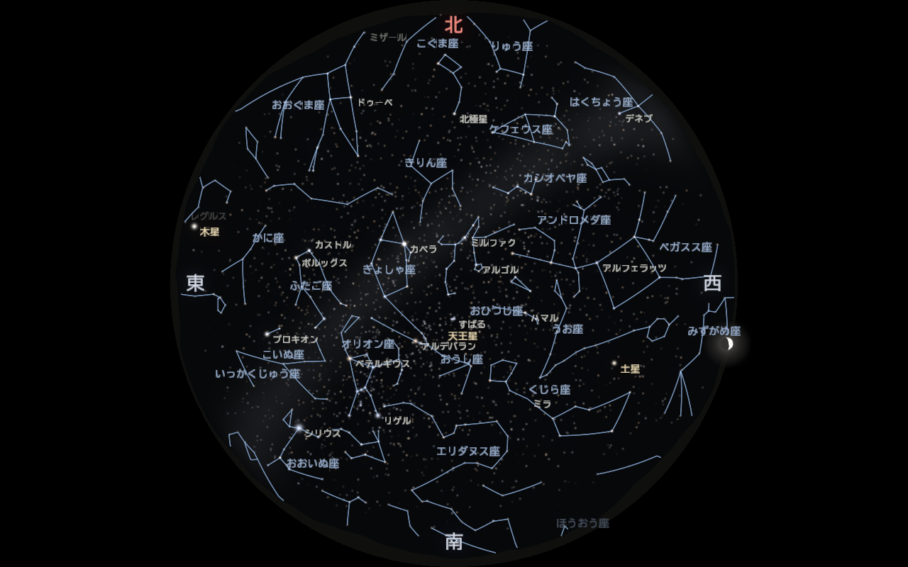

# 検証の記録

正しく動いているかを、何で・どう確かめたかの記録。2026-10-31 に実施（Intel Arc 130V、Windows 11、デバッグ画面 1280×800）。

**ここに書いた検証は、すべて 1 つのコマンドでやり直せる**（結果は `build/verify/report.md`）：

```sh
python tests/verify/verify.py
```

各節のコマンドは、その検証を個別に行うときのもの。スクリプトの説明は [tests/verify/README.md](../tests/verify/README.md)。

| 項目 | 方法 | 結果 |
|---|---|---|
| 天文計算 | 自動テスト（Meeus の例題、Astronomy Engine との比較） | 41 項目すべて合格 |
| 天体の位置 | Stellarium 26.3 と 32 天体を比較 | 最大の差 39″（画面の 1 画素の 5%） |
| 時刻・季節・シナリオ | 自動テスト | 22 項目すべて合格 |
| キー操作 | 自動テスト（全キー・Shift 付き）＋ 実際のウィンドウにキー入力を送る | 42 項目・26 回すべて合格 |
| 動き | 連続撮影してフレーム間の変化を測る | 瞬き・オーロラ・流れ星・フェードとも動いている |
| 描画速度 | `--benchmark` | 1280×800 で 109〜270 fps |
| 名前の重なり | 重ならない配置を選ぶ処理を入れ、画像で確認 | 重なりなし |

---

## 1. 自動テスト

```sh
cmake --build --preset mingw-debug
ctest --preset mingw-debug        # 3 つのテスト（astro / clock / controls）
```

| テスト | 内容 | 項目数 |
|---|---|---|
| [astro](../tests/astro_test.cpp) | ユリウス日、恒星時・歳差・太陽（Meeus 例題）、南中・東の地平線・天の北極、大気差、Astronomy Engine との比較（4 星 × 3 日時の高度・方位、太陽） | 41 |
| [clock](../tests/clock_test.cpp) | 日時の文字列、倍率・逆再生・一時停止、季節の巡回（年またぎ）・直接ジャンプ・自動巡回、シナリオの進行・ループ・停止 | 22 |
| [controls](../tests/controls_test.cpp) | すべてのキー（0〜9、M、L、S、F1〜F5、T、↑↓、Space、R、←→、N、K、J、C、G、I、V、P、F11、Esc、H）と Shift の組み合わせ、押しっぱなし、離したときは無視、ウィンドウが無くても落ちない | 42 |

## 2. Stellarium との比較

Stellarium（定番のプラネタリウムソフト）にスクリプトで同じ日時・場所を設定し、天体の **大気差を除いた高度・方位** を出力させて、
このプログラムの `--dump-positions` の値と比べた。

```sh
./run.sh --location osaka --time "2026-12-15 22:00" --dump-positions
./run.sh --location achi  --time "2027-08-10 21:00" --dump-positions
```

Stellarium 側のスクリプト（`--user-dir` で作業用フォルダを指定して起動）：

```js
core.setObserverLocation(135.52, 34.82, 50, 0, "osaka", "Earth");
core.setDate("2026-12-15T13:00:00", "utc");          // = 22:00 JST
var info = core.getObjectInfo("Sirius");
core.output("Sirius " + info["altitude-geometric"] + " " + info["azimuth-geometric"]);
```

| | 大阪 2026-12-15 22:00 | 阿智村 2027-08-10 21:00 | 最大の差 |
|---|---|---|---|
| 恒星 8 個（シリウス・ベテルギウス・リゲル・カペラ・ベガ・北極星・アルデバラン・デネブ） | 18〜26″ | 6〜39″ | **39″**（0.011°） |
| 太陽・水星・金星・火星・木星・土星・天王星 | 2〜12″ | 0.5〜12″ | **12″** |
| 月 | 1.7″ | 8.4″ | **8.4″** |

抜粋（大阪、高度と方位 [°]）：

| 天体 | 高度（本プログラム） | 高度（Stellarium） | 方位（本プログラム） | 方位（Stellarium） |
|---|---|---|---|---|
| シリウス | 21.897 | 21.892 | 131.134 | 131.138 |
| カペラ | 68.085 | 68.079 | 51.698 | 51.706 |
| 北極星 | 35.439 | 35.434 | 359.895 | 359.901 |
| 月 | 2.866 | 2.865 | 256.350 | 256.350 |
| 木星 | 3.703 | 3.702 | 76.342 | 76.341 |
| 土星 | 35.035 | 35.038 | 242.219 | 242.218 |

**評価**：魚眼の 1 画素は約 0.22°（≒ 810″）なので、最大 39″ は 1 画素の 5% 以下で、画面上は完全に一致する。
恒星の差の大部分は、このプログラムが省いている章動（〜17″）・年周光行差（〜20″）・固有運動による
（例：シリウスは固有運動が 1 年 1.3″ で、J2000 から 27 年で約 35″ 動く。差 39″ とほぼ一致）。

> 画面どうしの比較は、この PC では Stellarium の魚眼の画面がスクリプトから正しく撮れなかった
> （すべてが画面中央に集まる）ため、数値の比較のみ。目で比べるときは Stellarium を普通に起動して並べる。

## 3. キー操作

### 自動テスト
`tests/controls_test.cpp` が、GLFW のキーコールバックと同じ関数 `handleKey()` にすべてのキーを送る（上の表）。

### 実際のウィンドウ
[tests/verify/verify.py](../tests/verify/verify.py) の `keys` がアプリを起動し、Windows のキー入力メッセージ（WM_KEYDOWN / WM_KEYUP）を
ウィンドウに送って、アプリのログに期待した行が出るかを調べる。GLFW がキーを受け取ってから処理するまでの経路を確かめられる。

```sh
python tests/verify/verify.py --only keys
```

結果：26 回（モード、観測地、季節、自動巡回、時間倍率、一時停止、逆再生、現在時刻、星座線、名前、方位、グリッド、画面表示、
投影の切り替え、シナリオ再生・停止、全画面 → 戻す、ヘルプ、Esc で終了）すべて合格。
Shift との組み合わせはこの方法では送れないので、自動テストで確かめている。

## 4. 動き

`--record` で一定間隔に連続撮影し、隣り合うフレームの差を測った（640×400）。

```sh
./run.sh --mode aurora --record aurora --count 3 --interval 1.0   # aurora_000.png 〜 aurora_002.png
```

| 動き | 撮影 | 結果 |
|---|---|---|
| 瞬き（宝石箱モード） | 0.15 秒ごと × 4 | 毎回、画面の 2.2〜2.4% の画素がはっきり変わる |
| 瞬き（リアルモード） | 0.15 秒ごと × 3 | 星の画素が 1 割前後明るさを変える（控えめ）。最初は 0.04 等で変化がほぼ 0 だったので 0.12 等に強めた |
| オーロラ | 1 秒ごと × 3 | 0.5〜1% の画素が変わり、カーテンの筋が流れる。最初は筋が弱く緑の帯に見えたので、筋のコントラストと揺れを強めた |
| 流れ星 | 0.2 秒ごと × 6 | フレームごとに別の流れ星が現れて進む。短く暗かったので太さと明るさを上げた |
| フェード（リアル → 宝石箱） | 0.25 秒ごと × 6 | 平均の明るさが 6.7 → 6.7 → 9.4 → 11.7 → 13.2 → 13.6 と 1 秒かけて滑らかに変わる（飛ばない） |

## 5. 描画速度

垂直同期を切って 5 秒間描き、平均を測った（Release ビルド、1280×800、阿智村 2026-12-15 22:00）。

```sh
./run.sh --release --mode warp --benchmark 5
```

| 条件 | fps | 1 フレーム |
|---|---|---|
| リアル（阿智村） | 220 | 4.5 ms |
| リアル（大阪） | 270 | 3.7 ms |
| リアル ＋ 星座線・名前・方位・画面表示 | 210 | 4.8 ms |
| オーロラ | 185 | 5.4 ms |
| 星雲 | 194 | 5.2 ms |
| 流星群 | 197 | 5.1 ms |
| 宝石箱 | 210 | 4.8 ms |
| ワープ航行 | 109 | 9.2 ms |
| 天の川 | 225 | 4.5 ms |
| 水鏡 | 217 | 4.6 ms |

どれも 60 fps（16.7 ms）を大きく上回る。いちばん重いワープ航行は、約 1,600 本の光跡を毎フレーム CPU で作っているため。
通常の実行では垂直同期で 60 fps に揃い、ウィンドウタイトルに現在の fps が出る。

## 6. 名前の重なり

[src/labels.cpp](../src/labels.cpp) が、名前を優先度の順（方位 → 月・惑星 → 明るい星 → 主要な星座）に、
画面上で他の名前と重ならない位置を探して置く（[rendering.md §13](rendering.md#13-文字)）。
置き場所が無い名前は省く（例：上の画像ではカペラと重なる「ペルセウス座」を省いている）。



## 7. プロジェクタ（Optoma ML1050ST+）

2026-11-01、Optoma を HDMI でつなぎ「拡張」表示で `python tests/verify/projector.py` を実行した。

| 確認 | 結果 |
|---|---|
| 認識 | Windows は "Optoma WXGA" と認識。アプリ（GLFW）からはモニタ名が "Generic PnP Monitor" になるので、主モニタ以外で 1280×800 のモニタを選ぶようにした |
| 全画面 | 1280×800 @ 60 Hz の全画面でプロジェクタに出て、操作パネルは PC の画面に出る |
| 見つけた不具合 1 | 操作パネルを出すと、全画面の出力が最小化されて星空が消えていた（GLFW は全画面のウィンドウがフォーカスを失うと最小化する）。`GLFW_AUTO_ICONIFY` を切って直した |
| 見つけた不具合 2 | `--benchmark` が全画面への切り替え（約 1 秒）も含めて平均していたので、値が大きくぶれた。最初の 1 秒を除くようにした |
| 描画速度 | 垂直同期あり 55〜60 fps（バッテリー駆動では 42〜48 fps に落ちることがあった）、なし 140〜170 fps |
| 軽くした | 天の川を毎フレーム計算していた（1 画素あたりノイズ 10 回以上）のを、起動時に全天の画像に描いて引くだけにした。阿智村の場面で垂直同期なし 90〜160 → 160〜170 fps |
| 電源 | ノート PC がバッテリー駆動だった。内蔵 GPU は電池だと性能を落とすので、上映は充電器につなぐ（スクリプトが警告する） |
| Windows | スマート アプリ コントロールが、ビルドし直した exe（Debug・Release のどちらも）を止めたことがあった。`run` / `show` は Release が止められたら自動で Debug で起動する |

### 人の目と耳での調整（2026-11-01）

テストパターン（`X`）を投影し、人が見て合わせた。値は `config/projector.yaml` に書いた。

| 確認 | 結果 |
|---|---|
| 灰色 17 段（明るい側） | はじめは右端 3 段（224・240・255）が同じ白に見えた（白とび）。出力の最大値 `render.white_level` を足して 0.82 にし、全段が見分けられた。実行中に `[` / `]` で変えられる |
| 暗部 9 段 | いちばん左（真っ黒）まで見える（黒浮き）。暗い段はすべて見分けられるので、暗い星の描き分けは問題ない |
| Optoma 本体の設定 | 明るさ 6・コントラスト 10（10 段階）。白の最大値 0.82 と組み合わせて、全段が見分けられる |
| ピント（市松模様）・台形（格子）・北の向き（赤い線） | すべて問題なし（台形はプロジェクタ本体の補正で足りた） |
| 音 | アプリ側は上限（ナレーションはリミッタで約 2 倍、BGM は以前の 5 倍）。Windows の音量 100%、出力先は Optoma（HDMI）。Optoma 本体の音量 5（10 段階）で十分に聞こえた |
| 上映 | `show.ps1 --release` で全画面に出て、方角の説明・字幕・ナレーション・BGM が流れる。Space で一時停止・再開 |
